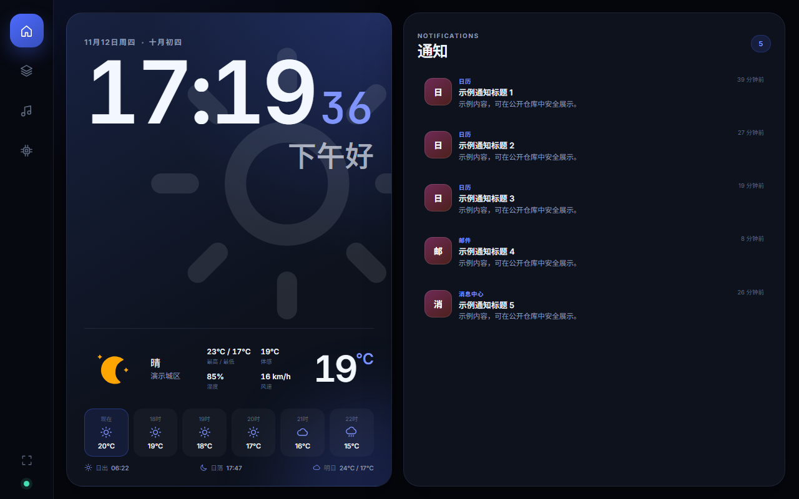
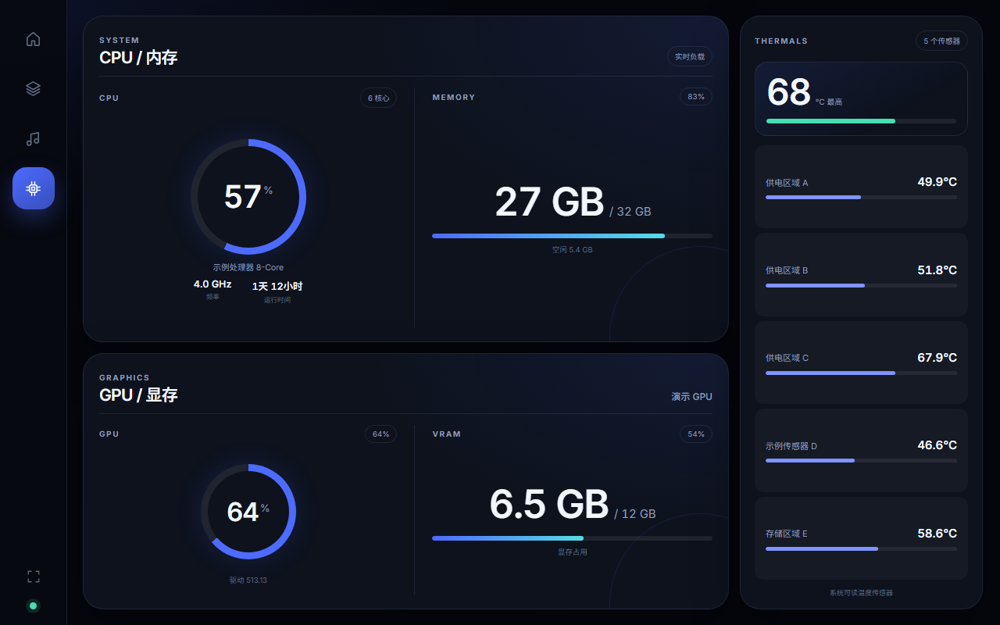

# dsh-remote-control

把同一局域网内的手机浏览器变成 DeepSeek Harness 的触屏中控台。插件运行在 DSH Desktop 的 Host 侧，手机端通过 WebSocket 接收实时状态。

主布局面向 **1280×800 横屏**：左侧导航栏、深蓝配色、大号时钟、分区卡片。手机端没有网站 Logo、标题栏和设置入口，内容直接开始。

如何安装：复制该项目地址给你的 DSH，让大肥鱼代劳帮你安装。

## 安装（DSH）

本仓库同时包含三份源码：Host 与浏览器端 TypeScript（`src/dsh`）、手机端 Svelte（`src/svelte`）和 Rust 原生探针（`src/rust`）。仓库只提交源码：`index.js`、`client.js`、`lib/`、`web/`、`native/bin/` 都是本机编译产物，已用 `git rm` 从版本库删除并加入 `.gitignore`。因此安装后必须先在插件目录编译一次，插件才能加载。

1. 在 DSH 的插件管理中安装本插件。
2. 进入插件安装目录执行一次：

   ```powershell
   pnpm install
   ```

   这会安装二维码库、`@fontsource-variable` 字体包、Svelte 5 / Vite 构建工具，以及 TypeScript / `@types` 开发依赖。`postinstall` 依次执行三个编译步骤：
   - `node scripts/build-dsh.mjs`：把 `src/dsh` 编译成插件根目录的 `index.js`、`client.js` 和 `lib/**/*.js`。`client.js` 由脚本包装成 DSH 浏览器模块工厂（`window.__ModuleLoader__`）格式。
   - `node scripts/build-web.mjs`：把 `src/svelte` 编译成 `web/`，字体由 Vite 随 CSS 打包进 `web/assets/`。
   - `node scripts/build-rust.mjs --optional`：检测到 `cargo` 时构建 Rust 探针；没有 Rust 工具链时只打印提示并继续。
3. 如果修改了 `src/dsh`、`src/svelte` 或 `static/`，手动重新编译：

   ```powershell
   pnpm build        # src/dsh + src/svelte
   pnpm build:dsh    # 只编译 Host / 浏览器端 TypeScript
   pnpm build:web    # 只编译手机端页面
   ```

   源码全部在 `src/` 下，Vite 公共资源在 `static/`。`index.js`、`client.js`、`lib/`、`web/` 是编译产物，不要手改；改动 `src/dsh/lib/service.ts` 或重新构建后，需要重新加载插件或重启 DSH。
4. 如果安装时没有 Rust 工具链，请手动构建原生探针：

   ```powershell
   node scripts/build-rust.mjs
   ```

   需要 Rust 工具链（Windows 还需 Visual Studio Build Tools 的“使用 C++ 的桌面开发”组件，因为构建会编译内置 SQLite；Linux 需要 gcc）。Windows 构建脚本会自动查找并加载 `vcvars64.bat`，也可用 `DSH_RC_VCVARS` 指定路径。**Rust 探针是唯一的系统探针层**：未构建时媒体、音量、性能、通知会返回明确的“探针不可用”错误，不再回退到 PowerShell / playerctl / osascript。详细说明见 [Rust 原生探针](#rust-原生探针dsh-probe)。
5. 重启 DSH（或重新加载插件）。

如果安装时禁用了 lifecycle scripts，请手动执行 `pnpm build`；字体被 Vite 打包进前端，不依赖系统字体。前端源码变更后执行 `pnpm build` 重新生成 `web/`。Rust 探针可另外执行 `node scripts/build-rust.mjs`，或设置 `DSH_RC_SKIP_RUST_BUILD=1` 跳过自动构建。

## 截图

手机端控制台，1280×800 横屏（截图使用随机生成的演示数据）：

| 首页 | 会话 |
|---|---|
|  |  |
| **音乐** | **性能** |
|  |  |

## 页面

| 页面 | 内容 |
|---|---|
| 首页 | 时钟、日期、天气、小时/7 天预报、可开关的番茄钟、Windows 通知列表、应用头像 |
| 会话 | 余额、今日/7 日消费、7 日金额背景柱状图、DSH 实时会话、子代理嵌套卡片、运行中已用时间、运行/等待/错误/结束状态 |
| 音乐 | 专辑封面、全屏模糊背景、歌曲信息、进度与 seek、上一首/下一首、播放暂停、系统音量、网易云红心、全屏 |
| 性能 | CPU、内存、GPU、显存、系统可读温度传感器 |

- 四页可左右循环滑动：最后一页继续滑到第一页，反向同理。
- 横屏下每页固定为一屏高，通知、会话、温度传感器列表在卡片内部滚动；竖屏才允许整页上下滚动。
- 页面顺序和开关在 DSH 设置页配置；关闭的页面不会出现在手机导航栏，也不会继续轮询对应数据。
- 导航栏位置可在 DSH 的偏好设置中选择左侧、右侧、上方或下方。
- 会话页左侧余额、消费、状态三个卡片在紧凑视口中保持完整可见；会话列表独立滚动。
- 子代理会话嵌套在派发它的主代理卡片内，并向右缩进；运行中的会话显示来自 DSH 的累计已运行时间。

## DSH 侧边栏

侧边栏入口名为 **远程控制台**，使用 DSH 原生设置页风格：单级左侧菜单、右侧独立滚动内容区。

菜单：

1. **连接**：配对二维码、控制台地址、开放网卡、链接验证、HTTPS 证书。
2. **偏好设置**：温度单位、主题、页面顺序与开关、导航栏位置。
3. **番茄钟设置**：启用开关、专注/休息时长、可选的提示音文件（留空使用内置轻柔提示音）、循环响铃直到停止。
4. **天气设置**：自动定位或手动位置、小时/7 天显示。
5. **余额显示**：本周/最近 7 天统计、低余额提醒线、显示梁文峰/梁文谷时段图标。
6. **通知设置**：通知应用筛选、显示数量（1–20）。
7. **系统信息**：服务状态、已连接设备、诊断信息。

### 批量保存

所有设置先在本地暂存，修改开关、主题、页面顺序、导航栏位置、番茄钟、天气、余额等不会立即提交。点击右上角 **保存设置** 后一次性提交并生效。

页面顺序支持拖拽：

- 拖动时原选项折叠消失，目标位置出现虚线占位。
- 拖到列表底部的投放区可以移动到末尾。
- 每行右侧开关控制该页面是否启用。

## 实时通信

手机端使用原生 WebSocket，地址为 `/ws`，不使用 HTTP 轮询。

- 连接后 Host 发送 `welcome`、`overview`，以及已启用页面对应的 `media` / `performance` 初始快照。
- 会话、通知、余额、天气、媒体、性能由 Host 主动推送。
- 音乐操作（播放暂停、切歌、seek、音量、静音、红心）通过 WebSocket 发送。
- 手机端 HTTP 只用于首次页面、`/assets/` 下打包后的 Svelte JS/CSS、字体和天气图标。
- 手机端字体由 Host 自托管：`@fontsource-variable/inter`、`@fontsource-variable/noto-sans-sc`、`@fontsource-variable/jetbrains-mono` 在构建时由 Vite 随 CSS 打包到 `web/assets/`；不依赖手机系统字体。字体许可为 SIL OFL 1.1，见 `web/fonts/LICENSE.txt`。
- 首页时钟、日期与问候语直接读取手机本地时间，WebSocket 不传输电脑时间。
- 没有连接设备时停止推送循环；单页被关闭时跳过该页轮询。

## 番茄钟

- 在 DSH 的「番茄钟设置」中启用后，番茄钟显示在手机端时钟与天气之间，用上下分割线区分且不带卡片背景；关闭后组件会从手机端整个卸载。
- 计时逻辑只在手机浏览器中运行；倒计时基于绝对结束时间，切换到其他页面或标签页不会丢失进度。
- 时间到会播放提示音：可在 DSH 中配置本机音频文件或 http(s) 链接，留空则使用内置的轻柔琶音提示音。
- 可在 DSH 中开启「循环响铃直到停止」：时间到后声音会持续循环，直到在手机端点击「停止响铃」；关闭该选项时只播放一次。
- 时间到时浏览器标签页会显示绿色提示点，样式与会话状态点一致。

## 天气

- 自动模式优先调用系统定位 API：Windows WinRT Geolocation、Linux GeoClue2；系统定位被拒绝或不可用时回退 IP 定位（`https://ipwho.is/`），再失败使用时区兜底。
- 手动模式保存名称、纬度、经度。
- 温度单位支持摄氏度（°C）与华氏度（°F）；在 DSH 插件设置的「温度单位」中切换后，天气、小时/7 天预报以及性能页传感器统一使用完整单位符号。
- 天气数据来自 Open-Meteo，无需 API Key。
- 图标来自 [`hasscc/tianqi`](https://github.com/hasscc/tianqi) 使用的彩云动态图标集：
  - 大天气图标为无描边填充样式。
  - 小时/7 天小图标和背景水印为静态线框样式。

## 余额与会话

- 余额来自 DSH 账户接口。
- 用量支持两种统计窗口：
  - **本周**：周一 00:00 至今。
  - **最近 7 天**：今天及之前 6 个自然日。
- 会话页显示近 7 日每日消费柱状图；柱子直接作为消费卡背景，最高金额日为 100% 高度。
- 会话状态包括：运行中（绿）、等待回答（黄）、错误（红）、已结束。
- 会话导航图标在等待回答或错误时显示黄/红提醒点。
- 余额卡片右下角可显示淡淡的时段图标：工作日北京时间 9:00–12:00、14:00–18:00 为梁文峰（高峰，显示山峰图标）；其余时间、周末及节假日全天为梁文谷（空闲，价格为高峰的一半，显示月亮图标）。
- 时段判断完全在手机浏览器中完成；法定节假日仅以 timor.tech API 返回的数据为准，不在本地推算放假政策。可在 DSH 的「余额显示」中关闭该图标。

## 音乐与网易云

- Rust 原生探针是唯一媒体层：Windows 通过 WinRT SMTC、Linux 通过 MPRIS（zbus/D-Bus）、macOS 通过 `nowplaying-cli`/AppleScript（源码提供，未在 macOS 实机测试）。
- 探针二进制不存在或命令失败时，媒体/音量返回明确的错误状态，不再回退到 PowerShell SMTC、C# 封面 DLL、`playerctl` 或 `osascript`。
- Windows SMTC 提供当前媒体、播放状态、封面、进度和可用控制；Rust 探针直接从 SMTC `Thumbnail` 流读取封面，包含 Edge/YouTube 封面。C# 辅助程序已删除。
- 只有播放器报告完整时间轴、允许定位，并且实际收到过非零播放位置时，进度条才可拖动。该规则在 `src/dsh/lib/media-enrich.ts` 中共用。
- 进度按 SMTC 的 `Position` 与 `LastUpdatedTime` 投影，并对轮询间的偏差做平滑修正，避免进度条回跳。
- 网易云封面与“喜欢”状态由 Rust 读取客户端本地数据：`Library/webdb.dat`（SQLite）匹配曲目/喜欢歌单，`Statics/*.dat` 读取最新封面；不调用网易云 URL 接口、不提取 Cookie、不依赖 DevTools 调试端口。Linux 为尽力路径（客户端数据目录不固定）。
- 红心状态是**只读展示**：音乐页显示“已喜欢/未喜欢”徽标，不能点击修改；WebSocket 只接受 `playpause`/`next`/`previous`/`seek`/`volume`/`mute`。
- 自动 seek/音量会短暂保持目标值，避免播放器状态回传造成跳回。

## 性能

- 布局：左侧上方为 CPU / 内存组合卡，下方为 GPU / 显存组合卡，右侧单列显示温度传感器。
- 所有系统性能数据由 Rust `performance` 子命令读取：CPU/内存来自 sysinfo，Windows 当前频率来自 PDH `% Processor Performance`，Linux 来自 `/proc/cpuinfo` / cpufreq。
- Windows GPU：名称/适配器/驱动/显存来自 DXGI（注册表兜底），利用率和专用显存来自 PDH GPU 性能计数器；温度来自 PDH `Thermal Zone Information`。不再使用 WMI 或 PowerShell。
- Linux GPU：`nvidia-smi` 或 AMD `sysfs`（`gpu_busy_percent`、`mem_info_vram_*`），温度来自 `nvidia-smi` + `/sys/class/hwmon`；Intel 核显不伪造利用率。
- macOS GPU/温度不实现（源码级，未测试）。
- 探针不可用时，Node 只用 `os.cpus()` / `os.totalmem()` 提供纯 JS 的 CPU/内存兜底；GPU 与温度返回空/错误状态，不使用 WMI/PowerShell。
- 系统没有暴露温度传感器时，页面显示“0 个传感器”，不会伪造读数。
- 性能页关闭时不执行 GPU/温度探测。

## 安全

- 默认生成随机访问令牌，可关闭或轮换；轮换会断开现有设备。
- 可只允许指定网卡的子网访问；回环地址始终放行。
- 可选 HTTPS：填写 PEM 证书和私钥路径；无效证书会回退 HTTP 并显示错误。
- 设置保存在 `DSH_HOME/remote-control/settings.json`（存在 `DSH_PROFILE_DIR` 时优先使用该目录）。
- 通知应用缓存保存在同目录 `notification-cache.json`。
- 仓库不包含本机路径、令牌、证书或通知内容。

## 原生探针架构

WinRT、Core Audio、D-Bus/MPRIS、GeoClue、DXGI/PDH、sysfs 等系统接口无法从 WASM 或纯 Node 访问，因此这里使用**原生 sidecar**（`src/rust`，Cargo 项目），而不是 WASM。

- 探针是**唯一**的 OS 探测层：媒体、音量、性能/GPU/温度、通知、位置都由 `dsh-probe` 提供。
- 已删除 PowerShell 探针、C# SMTC 封面辅助程序，以及 `playerctl`/`wpctl`/`pactl`/`amixer`/`osascript` 的 JS 媒体/音量适配器。
- 探针缺失时，`src/dsh/lib/probe.ts` 明确报告不可用；媒体/音量/性能/通知返回空或错误状态，不再静默回退。
- Node 仍负责：NetEase 数据之外的账户、会话、天气 HTTP、WebSocket/HTTP 服务、设置、通知应用缓存，以及 MPRIS HTTP 封面下载与媒体进度平滑。
- 位置：Windows 调用 WinRT Geolocation；Linux 调用 GeoClue2；macOS 因 CoreLocation 需要应用包身份而返回错误，Node 随后回退 IP/时区。手动坐标仍可在设置中填写。

## Rust 原生探针（dsh-probe）

Node 只负责派生进程、解析 JSON、缓存与展示，系统探测由 Rust 完成。

### 覆盖范围

| 能力 | Windows | Linux | macOS |
|---|---|---|---|
| 媒体读取/控制 | WinRT SMTC | MPRIS over D-Bus（zbus） | `nowplaying-cli`，否则 AppleScript（源码，未测试） |
| 封面 | SMTC `Thumbnail` 流 → data URL（含 Edge/YouTube） | `file://`/`data:` 直接读取；HTTP(S) 由 Node 下载 | `nowplaying-cli` artwork |
| 音量 | Core Audio `IAudioEndpointVolume` | `wpctl` → `pactl` → `amixer`（在 Rust 内调用） | `osascript`（在 Rust 内调用，未测试） |
| NetEase 封面/喜欢 | 本地 `webdb.dat` + `Statics` | 本地客户端数据（尽力） | 本地客户端数据（尽力） |
| CPU/内存/频率/使用率/运行时间 | sysinfo + PDH `% Processor Performance` + 注册表 | sysinfo + `/proc/cpuinfo` + cpufreq | sysinfo + `sysctl`（未测试） |
| GPU/温度 | DXGI + PDH GPU/Thermal Zone 计数器 | `nvidia-smi` 或 AMD sysfs + `/sys/class/hwmon`（尽力） | 不实现 |
| 通知 | 通知中心 SQLite 数据库 | `org.freedesktop.Notifications` D-Bus 监视（zbus） | 通知中心 SQLite 数据库（源码，未测试） |
| 位置 | WinRT Geolocation | GeoClue2 | CoreLocation 不可用于无 bundle 的 sidecar，回退 IP |

天气、账户、会话、HTTP/WebSocket、NetEase 应用缓存仍为 Node；系统探测（含 NetEase 本地库读取）全部在 Rust。

### 构建

产物路径固定为 `native/bin/<platform>-<arch>/dsh-probe[.exe]`（例如 `win32-x64`、`linux-x64`、`darwin-arm64`）。Rust 源码在 `src/rust`；`native/bin/`、`src/rust/target/` 均被 `.gitignore` 忽略，不随仓库或 npm 包分发；用户需要在本机构建一次。`pnpm install` 的 `postinstall` 会在检测到 `cargo` 时自动执行本脚本（失败不阻断安装），设置 `DSH_RC_SKIP_RUST_BUILD=1` 可跳过自动构建。

Windows（需要 Rust 1.89+ 与 MSVC 工具链；构建会编译内置 SQLite，因此必须有“使用 C++ 的桌面开发”组件）：

```powershell
node scripts/build-rust.mjs
# 脚本会自动查找并加载 vcvars64.bat；也可用 DSH_RC_VCVARS 指定
# 等价手动命令（需在 Developer PowerShell 中执行）：
cargo build --release --manifest-path src/rust/Cargo.toml
# 产物：native\bin\win32-x64\dsh-probe.exe
```

Linux（Fedora/RHEL）：

```bash
sudo dnf install -y gcc gcc-c++ make
curl --proto '=https' --tlsv1.2 -sSf https://sh.rustup.rs | sh -s -- -y
source "$HOME/.cargo/env"
node scripts/build-rust.mjs
# 或手动：
cargo build --release --manifest-path src/rust/Cargo.toml
# 产物：native/bin/linux-x64/dsh-probe
```

Debian/Ubuntu 把 `dnf` 换成 `sudo apt install build-essential`。MPRIS 需要会话 D-Bus；GeoClue2 需要 `geoclue2` 服务与桌面授权；音量后端按 `wpctl`、`pactl`、`amixer` 顺序探测。

macOS：

```bash
xcode-select --install
curl --proto '=https' --tlsv1.2 -sSf https://sh.rustup.rs | sh -s -- -y
source "$HOME/.cargo/env"
node scripts/build-rust.mjs          # native/bin/darwin-<arch>/dsh-probe
cargo check --manifest-path src/rust/Cargo.toml --features macos-check   # 在任意平台类型检查 macOS 模块
```

**macOS 仅提供源码，未在 macOS 实机或 CI 构建/测试。** 媒体读取优先 `nowplaying-cli`（`brew install nowplaying-cli`），否则用 AppleScript 查询 Music/Spotify；音量用 `osascript`；通知读取通知中心数据库；GPU/温度不实现；位置因 CoreLocation 需要应用包身份而回退 IP。当前未添加 CI/CD；以后可在 macOS runner 上补跑 `node scripts/build-rust.mjs` 与 `cargo test`，但 macOS 行为仍需实机验证。

### 命令

```text
dsh-probe version
dsh-probe media read [--app-id ID] [--no-thumbnail]
dsh-probe media playpause|next|previous|seek --position SECONDS [--app-id ID]
dsh-probe volume read
dsh-probe volume set --value 0.0..1.0
dsh-probe volume toggle
dsh-probe performance
dsh-probe notifications [--limit 1..20]
dsh-probe notifications watch [--limit 1..20]   # Linux 流式输出
dsh-probe location
```

每条命令输出一行 JSON。探针内部错误返回 `{"ok":false,...}` 且退出码为 0（便于 Node 读取错误）；参数错误退出码为 2。

媒体载荷包含 `appId`、`title`、`artist`、`album`、`playbackStatus`、`position`、`startTime`、`endTime`、`minSeekTime`、`maxSeekTime`、`lastUpdatedAt`、`canPlayPause`、`canNext`、`canPrevious`、`canSeek`、`thumbnail`、`thumbnailType`，以及 NetEase 的 `liked`（`true`/`false`/`null`）、`canLike`、`trackId`。Linux MPRIS 的 HTTP(S) 封面通过额外的 `thumbnailUrl` 交给 Node 下载并转为 data URL，Rust 侧不引入 HTTP 客户端。

通知载荷：`available`、`reason`、`source`、`liveOnly`、`notifications[]`（`id`、`appKey`、`appName`、`title`、`body`、`avatar`、`hasImage`、`receivedAt`、`isGroup`）、`apps[]`（`key`、`name`、`count`）、`updatedAt`。`notifications watch` 每个通知输出一行同样的快照。

位置载荷：`ok`、`available`、`latitude`、`longitude`、`accuracy`、`source`、`error`。

### Node 桥

- `src/dsh/lib/probe.ts` 按 `process.platform` / `process.arch` 查找二进制并执行子命令；找不到时所有调用返回明确的不可用错误，并附带 `DSH_RC_TMPDIR`（工作区 `.probe-tmp/`）供探针复制只读 SQLite 数据库。
- `src/dsh/lib/probe-adapter.ts` 只调用 Rust 媒体/音量命令；失败直接返回错误或抛出，不再有 fallback。媒体进度平滑与 seek 规则复用 `src/dsh/lib/media-enrich.ts`。
- `src/dsh/lib/performance.ts` 只采用 Rust 的 `performance` 载荷；探针缺失时仅用 `os.cpus()`/`os.totalmem()` 提供 CPU/内存兜底，GPU/温度为空。
- `src/dsh/lib/notifications.ts`：Windows/macOS 调用一次性 `notifications`；Linux 启动 `notifications watch` 长进程并按行更新最近列表，退出后按冷却时间重启。Node 只做字段归一化、应用筛选与数量限制，payload 形状保持不变。
- 环境变量：`DSH_RC_PROBE=/absolute/path/to/dsh-probe` 指定自定义二进制；`DSH_RC_DISABLE_RUST_PROBE=1` 强制标记探针不可用（测试用）；`DSH_RC_TMPDIR` 覆盖临时目录；`DSH_RC_VCVARS` 覆盖 Windows 构建的 vcvars 路径。
- 网易云封面/喜欢由 `src/rust/src/vendor/netease` 读取；红心为只读展示，Node 不再有写红心或 CDP 代码。

### 测试

```bash
cargo test --manifest-path src/rust/Cargo.toml
cargo check --manifest-path src/rust/Cargo.toml --features macos-check
node test/probe-bridge.mjs
node test/notifications.mjs
node test/notification-watch.mjs
node test/smoke.mjs
node test/media-progress.mjs
```

已在本仓库验证：Windows 11 26H2（build 26300，x86_64-pc-windows-msvc，Rust 1.99.1）构建/测试通过；SMTC 媒体与控制、SMTC 封面（Edge/YouTube，data URL）、Core Audio 音量、DXGI/PDH GPU（RX 7800 XT，16 GB 显存）、通知中心（含头像）、WinRT 位置调用均验证（本机 Windows 位置权限为 Denied，Node 正确回退 IP）。Fedora 45 KDE（x86_64，Rust 1.99.1）构建/测试通过；MPRIS（Haruna + 静音 WAV 的读取、播放/暂停、seek、next）、wpctl 音量、sysinfo/温度、GeoClue2 位置、`notify-send` → D-Bus 通知监视均返回有效数据，测试后已清理播放器与临时文件。macOS 未测试。

### 已知缺口

- Windows 温度依赖 PDH `Thermal Zone Information`；本机没有 ACPI 热区实例（`typeperf` 返回 No valid counters），因此返回空数组，不伪造读数。未接入 LibreHardwareMonitor/OpenHardwareMonitor WMI。
- Windows 位置在本机被隐私设置拒绝（`GeolocationAccessStatus::Denied`）；Node 自动回退 IP 定位。启用系统定位权限后 Rust 路径可直接返回坐标。
- Linux 只读取 NVIDIA（`nvidia-smi`）和 AMD（sysfs）GPU；Intel 核显不显示利用率。温度取决于 `hwmon` 是否暴露传感器。
- Linux 通知监视依赖 D-Bus 的 `BecomeMonitor` 权限；部分加固系统可能拒绝，届时返回明确错误。
- macOS 媒体/音量/性能/通知/位置均为源码级实现，未测试；GPU/温度不实现；CoreLocation 不适用于无 bundle 的 sidecar。
- NetEase 本地数据库 schema 随客户端版本变化；匹配不到曲目时 `liked` 为 `null`、封面为空，不伪造。
- 构建产物不入库、不入 npm 包；发布二进制需要各平台自行构建（或后续补 CI 产物）。

## 平台

- **Windows**：Rust SMTC + Core Audio + DXGI/PDH 性能 + 通知中心数据库 + WinRT Geolocation；无 PowerShell/C# 回退。
- **Linux**：Rust MPRIS 媒体（zbus）、`wpctl`/`pactl`/`amixer` 音量、sysinfo + `/proc` + sysfs/hwmon 性能、D-Bus 通知监视、GeoClue2 位置。
- **macOS**：Rust 媒体/音量/性能/通知源码（`nowplaying-cli`/AppleScript/通知数据库）——未在 macOS 实机测试；位置回退 IP。
- 手机端：现代浏览器，WebSocket 可用。

## 目录

```text
index.js                编译产物：Host 入口、DSH webServer 路由（gitignore，pnpm build 生成）
client.js               编译产物：DSH 侧边栏设置页，包装为浏览器模块工厂（gitignore）
lib/                    编译产物：Host 逻辑（由 src/dsh/lib 生成，gitignore）
locale/                 DSH 侧边栏本地化资源
icon.svg                插件图标
vite.config.js          Vite + Svelte 构建配置（root = src/svelte，输出 web/）
svelte.config.js        Svelte 预处理器配置
tsconfig.json           Svelte 端 TypeScript / svelte-check 配置
tsconfig.dsh.json       Host TypeScript 编译配置（src/dsh → index.js + lib/）
tsconfig.dsh-client.json 浏览器端 TypeScript 编译配置（src/dsh/client.ts → client.js）
scripts/build-dsh.mjs   编译 src/dsh，写入插件根目录并生成模块工厂
scripts/build-web.mjs   编译 src/svelte，生成 web/
scripts/build-rust.mjs  编译 src/rust，产物写入 native/bin/
src/dsh/                Host + 浏览器端 TypeScript 源码
src/dsh/index.ts        Host 入口（export inject / apply）
src/dsh/client.ts       DSH 侧边栏设置页（React，TypeScript）
src/dsh/lib/service.ts  HTTP/WebSocket、配对、设置、推送
src/dsh/lib/ws.ts       最小 RFC6455 WebSocket 服务
src/dsh/lib/account.ts  余额、今日/7 日用量
src/dsh/lib/sessions.ts DSH 会话、子代理父子关系、运行起始时间与待回答/错误状态
src/dsh/lib/weather.ts  系统/IP 定位、Open-Meteo、7 天预报
src/dsh/lib/performance.ts Rust performance 载荷（仅 CPU/内存 JS 兜底）
src/dsh/lib/media-enrich.ts 媒体归一化、进度平滑、seek 规则
src/dsh/lib/probe.ts    Rust 探针定位、执行、JSON 解析、临时目录
src/dsh/lib/probe-adapter.ts Rust 媒体/音量适配器（无回退）
src/dsh/lib/notifications.ts Rust 通知服务（Linux watch / 其他一次性）
src/dsh/lib/platform/index.ts 组装媒体与通知适配器
src/dsh/lib/types.ts    共享 Host 类型契约
src/dsh/types/          第三方包的本地类型声明
src/svelte/             Svelte 5 + TypeScript 手机端源码
src/svelte/index.html   Vite HTML 模板（构建到 web/index.html）
src/svelte/lib/         状态、WebSocket、格式化、图标与媒体投影
src/svelte/lib/billing.svelte.ts 峰谷计费判断与 timor.tech 节假日 API
src/svelte/lib/pomodoro.svelte.ts 番茄钟计时、提示音与页面 tab 提示点
src/svelte/lib/session-tree.ts   会话/子代理嵌套树
src/svelte/lib/components/ 页面与卡片组件
src/svelte/styles/global.css 手机端全局颜色令牌、重置与共享基础样式
src/svelte/lib/components/**   组件结构、组件样式与交互
src/rust/               Rust 原生探针源码（Cargo 项目）
src/rust/src/vendor/    专用客户端读取（当前为 NetEase 本地库）
src/rust/target/        Cargo 构建缓存（gitignore）
native/bin/             探针构建产物（gitignore 忽略，需本机构建）
.probe-tmp/             探针只读 SQLite 副本的临时目录（运行时生成）
.build/                 TypeScript 编译暂存目录（gitignore）
static/                 Vite 公共资源（icon、manifest、天气图标、字体许可）
web/                    每次安装/构建生成的静态页面（gitignore，由 service 服务）
web/assets/             安装/构建时生成的 Svelte/Vite JS/CSS
web/fonts/              构建时从 static/ 复制的字体许可（woff2 在 web/assets/）
web/weather-icons/      构建时从 static/ 复制的彩云天气图标
docs/                   1280×800 手机端控制台截图
```

## 开发检查

```powershell
pnpm check                      # tsc（Host + 浏览器端）+ svelte-check
pnpm build                      # 编译 src/dsh 与 src/svelte
node test/smoke.mjs
node test/media-progress.mjs
node test/probe-bridge.mjs
node test/notifications.mjs
node test/notification-watch.mjs
cargo fmt --manifest-path src/rust/Cargo.toml -- --check
cargo test --manifest-path src/rust/Cargo.toml
cargo check --manifest-path src/rust/Cargo.toml --features macos-check
node scripts/build-rust.mjs
```

`pnpm dev` 启动 Vite 开发服务器；`pnpm preview` 预览 `web/` 构建产物。`pnpm build` 先编译 `src/dsh`（`node scripts/build-dsh.mjs`），再执行 Vite 构建（`node scripts/build-web.mjs`），字体与样式一起进入 `web/assets/`。
`pnpm check` 依次运行 `tsc -p tsconfig.dsh.json --noEmit`（Host）、`tsc -p tsconfig.dsh-client.json --noEmit`（浏览器端）和 `svelte-check --tsconfig ./tsconfig.json`（手机端）。
`test/smoke.mjs` 使用临时 `DSH_PROFILE_DIR` 启动服务，检查令牌页面、`/assets/` 静态资源、WebSocket welcome/overview，并确认旧 HTTP overview 路由不存在。
`test/probe-bridge.mjs` 验证探针缺失时媒体/音量的错误状态，以及没有静默回退。
`test/notifications.mjs` 验证通知字段归一化、数量限制、应用聚合与探针缺失时的错误载荷；`test/notification-watch.mjs` 用假探针验证 Linux 流式监视的逐行解析。

## 已知限制

- Rust 探针需要在目标机器上构建；仓库和 npm 包不包含二进制。未构建时不会回退 JavaScript 探针，媒体/音量/性能/通知会显示“探针不可用”。
- Windows 温度依赖 PDH 热区；主板/驱动未暴露 ACPI 热区时列表为空，不伪造读数。
- Windows 位置需要系统定位权限；被拒绝时 Node 回退 IP。macOS 的 CoreLocation 不适用于无 bundle 的 sidecar，同样回退 IP。
- Linux 的 Intel 核显不显示利用率；温度取决于 `hwmon`。
- SMTC 封面依赖播放器暴露缩略图；网易云使用本地缓存补齐。
- 网易云红心为只读展示，不提供写入。
- 手机端布局优先保证 1280×800 横屏；竖屏使用紧凑降级布局。
- 会话页只读；媒体和音量可写。
## 许可证

MIT。Inter、Noto Sans SC、JetBrains Mono 使用 SIL Open Font License 1.1；许可源文件为 `static/fonts/LICENSE.txt`，构建后位于 `web/fonts/LICENSE.txt`。
