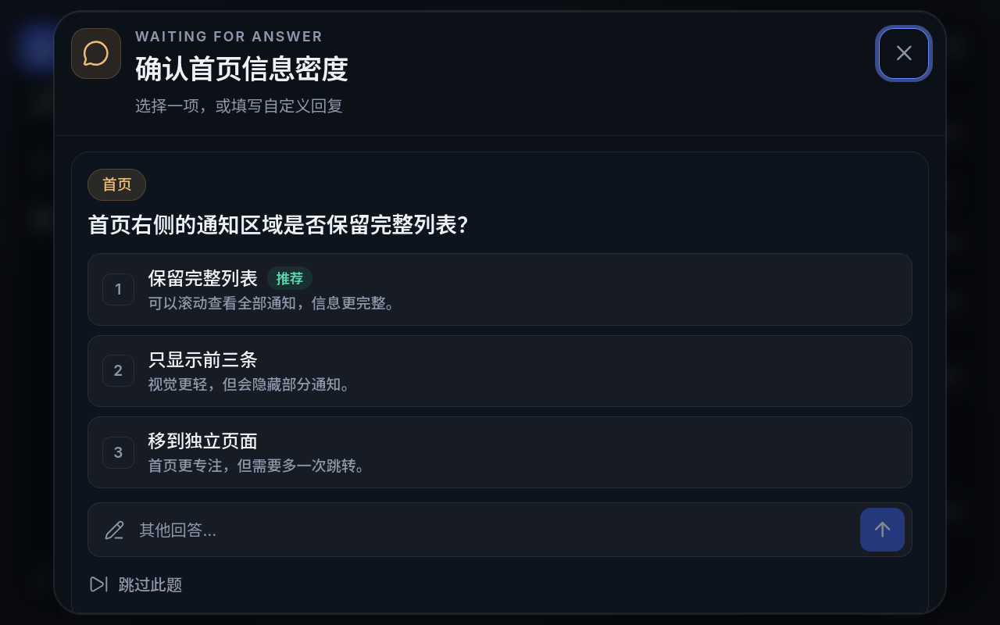

# dsh-remote-control

把同一局域网内的手机浏览器变成 DeepSeek Harness 的触屏中控台。插件运行在 DSH Desktop 的 Host 侧，手机端通过 WebSocket 接收实时状态。

界面基于 **Svelte 5 + shadcn-svelte + Tailwind CSS**，图标统一使用 **Lucide**。主布局面向小屏横屏触摸：窄导航栏、DeepSeek 深蓝、大号时钟与分区卡片。手机端没有网站 Logo、标题栏和设置入口，内容直接开始。

## 文档分工（给 agent）

仓库只有三份文档，职责严格分开：

| 文件 | 受众 | 内容 |
|---|---|---|
| [`README.md`](README.md)（本文件） | 终端用户 | 插件介绍、截图、功能说明。不写安装命令。 |
| [`INSTALLATION.md`](INSTALLATION.md) | 安装者 / agent | 唯一安装指南：GitHub 源码 clone → 构建 → `link:` 注册、Rust 探针、更新、卸载、故障恢复。 |
| [`AGENTS.md`](AGENTS.md) | 开发者 / agent | 架构、DSH 集成契约、HTTP/WebSocket、Rust 探针与媒体适配层、构建、测试、CI、已知缺口。 |

给 agent 的硬规则：

- 安装、更新、排障只按 `INSTALLATION.md` 执行，并先完成构建再注册 bundle。
- 本项目**不发布 npm 包**，不要用 `npm install`、`dsh plugin add github:...`，也不要把 GitHub 地址直接填进插件安装框。git 依赖不会执行本仓库的构建，缺少 `index.js` 时 DSH 会报 `Failed to load plugins` / `import failed`。
- 改用户可见行为就改本文件；改架构、协议、构建或测试就改 `AGENTS.md`；不要在本文件里写安装步骤，也不要在 `INSTALLATION.md` 里写架构说明。

## 截图

Fedora 实机全屏截图（演示数据），原生 1280×800 输出（系统缩放 1.45，逻辑视口 883×552）：

| 首页 | 会话 |
|---|---|
|  |  |
| **音乐** | **性能** |
|  |  |
| **提问弹窗** | |
|  | |

## 页面

| 页面 | 内容 |
|---|---|
| 首页 | 大号时钟与日期、当前天气和小时/7 天预报、可开关的大号番茄钟、通知列表；通知与天气图标统一使用 Lucide |
| 会话 | 余额、今日 / 本周消费、作为卡片背景的 7 日消费柱、实时会话与子代理嵌套、运行用时和状态；回答问题时弹出居中的触屏对话框 |
| 音乐 | 全屏模糊封面背景、大号歌曲信息、进度 seek、上一首/下一首、播放暂停、音量与静音、网易云红心（CDP 可写）、全屏 |
| 性能 | 左侧 CPU / 内存与 GPU / 显存卡片，用圆环显示占用率，下方是频率、运行时间、显存等数据；GPU 顶部胶囊显示驱动版本；右侧保留大号最高温度与传感器热区列表 |

- 四页可左右循环滑动：最后一页继续滑到第一页，反向同理；无论滑动速度多快，一次手势最多前进/后退一页，滑动过程中保持跟手。
- 横屏下每页固定为一屏高，通知、会话、温度传感器列表在卡片内部滚动；竖屏才允许整页上下滚动。
- 页面顺序和开关在 DSH 设置页配置；关闭的页面不会出现在手机导航栏，也不会继续轮询对应数据。
- 导航栏位置可在 DSH 的偏好设置中选择左侧、右侧、上方或下方；导航栏保持窄条，按钮适配触摸。
- 会话页左侧余额、消费、状态三个卡片在紧凑视口中保持完整可见；会话列表独立滚动。
- 子代理会话嵌套在派发它的主代理卡片内，并向右缩进；运行中的会话显示来自 DSH 的累计已运行时间。
- 小屏优先使用放大字号和至少 44 px 的触控目标；不使用 hover 过渡或缩放动画。

## DSH 侧边栏

侧边栏入口名为 **远程控制台**，使用 DSH 原生设置页风格：单级左侧菜单、右侧独立滚动内容区。窗口较窄时左侧菜单自动变为下拉选择器，避免横向滚动。

菜单：

1. **连接**：配对二维码、控制台地址、开放网卡、链接验证、HTTPS 证书。
2. **偏好设置**：温度单位、主题、页面顺序与开关、导航栏位置。
3. **番茄钟设置**：启用开关、专注/休息时长、可选的提示音文件（留空使用内置轻柔提示音）、循环响铃直到停止。
4. **天气设置**：自动定位或手动位置、小时/7 天显示，以及 **请求定位权限** 按钮（被拒绝时会打开 Windows「位置」设置页）。
5. **余额显示**：本周/最近 7 天统计、低余额提醒线、显示梁文峰/梁文谷时段图标。
6. **通知设置**：所有应用默认开启通知，可逐项取消；显示数量（1–20）、是否推送问询。
7. **软件映射**：系统里出现过的所有通知/音乐应用，逐行修改显示名称并立即保存；恢复默认可清空自定义名称。映射同时用于手机端通知和音乐来源标签。
8. **系统信息**：服务状态（通知、媒体、音量、性能、定位、天气）、`dsh-probe` / Node.js 运行时信息（版本、平台、内存）、当前 DSH Profile、已连接设备、诊断信息。

### 批量保存

所有设置先在本地暂存，修改开关、主题、页面顺序、导航栏位置、番茄钟、天气、余额等不会立即提交。点击右上角 **保存设置** 后一次性提交并生效。

页面顺序支持拖拽：

- 拖动时原选项折叠消失，目标位置出现虚线占位。
- 拖到列表底部的投放区可以移动到末尾。
- 每行右侧开关控制该页面是否启用。

## 番茄钟

- 在 DSH 的「番茄钟设置」中启用后，番茄钟以一块大号触屏面板显示在手机端时钟与天气之间，与上下内容保持间距；关闭后组件会从手机端整个卸载。
- 计时逻辑只在手机浏览器中运行；倒计时基于绝对结束时间，切换到其他页面或标签页不会丢失进度。
- 时间到会播放提示音：可在 DSH 中配置本机音频文件或 http(s) 链接，留空则使用内置的轻柔琶音提示音。
- 可在 DSH 中开启「循环响铃直到停止」：时间到后声音会持续循环，直到在手机端点击「停止响铃」；关闭该选项时只播放一次。
- 时间到时浏览器标签页会显示绿色提示点，样式与会话状态点一致。

## 天气

- 自动模式优先使用系统定位；系统定位被拒绝或不可用时回退 IP 定位（`https://ipwho.is/`），再失败使用时区兜底。
- Windows 定位可能被系统隐私开关（「位置服务」/「允许桌面应用访问你的位置」）阻挡。DSH 设置页「天气设置 → 请求定位权限」会申请权限；被拒绝时自动打开「位置」设置页，授权成功后立即清空定位缓存并刷新天气。
- 手动模式保存名称、纬度、经度。
- 温度单位支持摄氏度（°C）与华氏度（°F）；在 DSH 插件设置的「温度单位」中切换后，天气、小时/7 天预报以及性能页传感器统一使用完整单位符号。
- 天气数据来自 Open-Meteo，无需 API Key。
- 天气与页面其他图标统一使用 Lucide；封面和通知头像支持本机 data URL，以及后端回传的 http(s) 图片地址。

## 余额与会话

- 余额来自 DSH 账户接口。
- 用量支持两种统计窗口：**本周**（周一 00:00 至今）和 **最近 7 天**（今天及之前 6 个自然日）。
- 会话页显示近 7 日每日消费柱状图；柱子直接作为消费卡背景，最高金额日为 100% 高度。
- 会话状态包括：运行中（绿）、等待回答（黄）、错误（红）、已结束；导航图标在等待回答或错误时显示黄/红提醒点。
- 开启「推送问询」后，等待回答的会话会出现「回答」提示：点击会话弹出居中的触屏对话框，展示全部问题、选项和自定义回复输入框；单选题点选项即可直接回复，多选题可多选后提交，也可以填写自定义回复或跳过该题。关闭该开关时，会话页仍只读。
- 手机控制台已连接且「推送问询」开启时，手机和 DSH 都会看到问题。手机提交的答案通过 DSH 正常的 `user-questions/request` 瀑布接口回到 Agent；超时后仍可回答的 continued 提问通过 `userQuestions.answer` 接口提交。DSH 自己的提问卡片仍会显示，远程回答后可能需要在该卡片上手动关闭，这是 DSH Web 客户端当前的行为。
- 余额卡片右上角显示高峰/低谷胶囊：工作日北京时间 9:00–12:00、14:00–18:00 为梁文峰（高峰，显示山峰图标）；其余时间、周末及节假日全天为梁文谷（空闲，价格为高峰的一半，显示月亮图标）。时段判断完全在手机浏览器中完成；法定节假日仅以 timor.tech API 返回的数据为准。可在 DSH 的「余额显示」中关闭该胶囊。

## 音乐与网易云

- 已适配网易云音乐、QQ 音乐、酷狗音乐、酷我音乐、汽水音乐、全民 K 歌、Spotify、Apple Music、YouTube Music，以及浏览器/其他 SMTC/MPRIS 播放器。媒体读取先识别播放软件：命中内置 vendor 适配时进入对应软件的逻辑，未命中才使用系统接口；不会伪造播放进度。网易云在系统接口（Windows SMTC / Linux MPRIS / macOS Now Playing）可用时由系统接口提供元数据/封面/播放状态/传输控制，CDP 只补精确进度和红心；系统接口完全不可用但 CDP 可用时，歌曲信息、封面 URL、进度、红心和播放控制全部走 CDP；两者都不可用时回到窗口/UIA 兜底，仍取不到就返回空。
- Windows 使用 WinRT SMTC，Linux 使用 MPRIS（zbus/D-Bus），macOS 为 `nowplaying-cli`/AppleScript 源码级实现（未在 macOS 实机测试）；已知客户端都会先进入对应 vendor 逻辑，再由 vendor 决定组合系统接口。
- 音乐页显示专辑封面、全屏模糊背景、歌曲信息、播放进度、上一首/下一首、播放暂停、系统音量和静音；进度条由 `SeekBar` 按 shadcn 控件视觉自实现，本地持续推进；触摸拖动松手后也会继续前进，不被缓存快照拉回；不支持 seek 时使用只读进度条，不出现不可用的拖拽把手；后端连总长度/当前长度都没有时，进度条显示满格，两个时间都显示 `--:--`；网易云红心在 CDP 可用时可点击切换，未登录时点击会打开登录页且状态不变，系统接口可用时传输控制仍走系统接口，系统接口不可用且 CDP 可用时播放控制走页面按钮；未开启 CDP 时红心显示为未知（不读取本地数据库）。
- **可拖动 seek 的来源**：完整系统会话（SMTC/MPRIS/MediaRemote）；需要标题、有效时间轴、播放器允许定位，并且实际收到过非零位置。网易云 CDP 仅补齐进度/红心，不授予 seek；私有窗口标题和 UI Automation 只展示播放进度，不提供 seek；读不到进度时不会伪造。
- 不调用外部歌曲/封面数据 API：网易云在 SMTC 开启时封面来自 SMTC，CDP-only 时使用客户端歌曲数据里的封面 URL（由控制端浏览器直接加载并缓存）；仅窗口标题兜底路径才使用本地缓存。红心与精确进度可选使用本机回环 CDP（客户端带 `/remote-debugging-port=2015` 启动，详见[安装文档](INSTALLATION.md#网易云音乐-cdp可选红心精确进度)），不提取 Cookie、不调用网易云/QQ 音乐的数据接口。
- 自动 seek/音量会短暂保持目标值，避免播放器状态回传造成跳回。

## 性能

- 左侧两张卡片分别显示 CPU / 内存和 GPU / 显存；CPU 与 GPU 使用圆环指示占用率，不再使用横向占用条。
- 圆环下方的小卡片显示当前频率、运行时间、已用 / 可用内存、显存和核心/显存频率；CPU 线程、内存总量、GPU 驱动和显存总量统一使用胶囊样式，并与左右小卡片顶格对齐。
- 右侧温度栏保留大号最高温度与传感器热区背景，GPU 核心温度、磁盘温度和 ACPI 热区在同一列表内；传感器多时在卡片内滚动。
- CPU 温度仅能来自 ACPI 热区，未暴露时显示「未提供」，不伪造读数；系统没有暴露任何温度传感器时显示“暂无温度读数”。
- 性能数据由可选的原生探针读取；探针不可用时，CPU / 内存用纯 JS 兜底，GPU 与温度显示为空/错误状态。性能页关闭时不执行 GPU/温度探测。

## 通知与软件映射

- Rust 探针读取系统通知：Windows 读取通知中心数据库并原样上报应用标识（`appKey`）；Linux 通过 D-Bus 监视；macOS 读取通知中心数据库（源码级，未实测）。中文名称由 Node 侧的软件映射生成。
- 插件在 Node 侧维护 `app-mapping.json`：记录出现过的应用、来源（通知/音乐）、首次/最近出现时间与通知计数，并保存用户改写的名称。
- 内置默认名称覆盖常见的 Windows 应用（QQ、哔哩哔哩、Discord、Terminal、VS Code、Edge、Outlook 等），其余应用按可执行文件名、AUMID、MPRIS 名称自动推导。
- DSH 设置页「软件映射」可逐个改名或恢复默认；保存后立即用于手机端通知和音乐页的来源标签。旧版 `notification-cache.json` 会在首次启动时自动迁移到 `app-mapping.json`。

## 安全

- 默认生成随机访问令牌，可关闭或轮换；轮换会断开现有设备。
- 可只允许指定网卡的子网访问；回环地址始终放行。
- 可选 HTTPS：填写 PEM 证书和私钥路径；无效证书会回退 HTTP 并显示错误。
- 设置保存在 `DSH_HOME/remote-control/settings.json`（存在 `DSH_PROFILE_DIR` 时优先使用该目录）；通知/音乐应用历史与软件映射保存在同目录 `app-mapping.json`。
- 仓库不包含本机路径、令牌、证书或通知内容。

## 平台与探针

- **Windows**：媒体、音量、性能/GPU/温度、通知、定位均由 Rust 原生探针提供；无 PowerShell / C# 回退。
- **Linux**：Rust 探针使用 MPRIS、`wpctl`/`pactl`/`amixer`、sysinfo/sysfs、D-Bus 通知监视和 GeoClue2；GPU 仅支持 NVIDIA / AMD，Intel 核显不显示利用率。
- **macOS**：提供媒体/音量/性能/通知源码，未在实机或 CI 验证；GPU/温度不实现，定位回退 IP。
- **手机端**：现代浏览器，WebSocket 可用。
- Rust 探针是可选的：未构建时媒体、音量、通知、GPU/温度会显示“探针不可用”，系统定位回退 IP/时区，CPU/内存仍可用；构建方式见 [`INSTALLATION.md`](INSTALLATION.md)。

## 安装

本项目只支持从 GitHub 源码安装：**clone → 本机构建 → 用 `link:` 注册到 DSH**。不发布 npm 包，也不支持把仓库地址直接交给插件管理器安装。

完整步骤（前置条件、构建、Rust 探针、更新、卸载、故障恢复）见 [`INSTALLATION.md`](INSTALLATION.md)。

## 许可证

MIT。Inter、Noto Sans SC、JetBrains Mono 使用 SIL Open Font License 1.1；许可源文件为 `static/fonts/LICENSE.txt`，构建后位于 `web/fonts/LICENSE.txt`。界面组件来自 MIT 许可的 shadcn-svelte 与 bits-ui，图标来自 ISC 许可的 Lucide。
