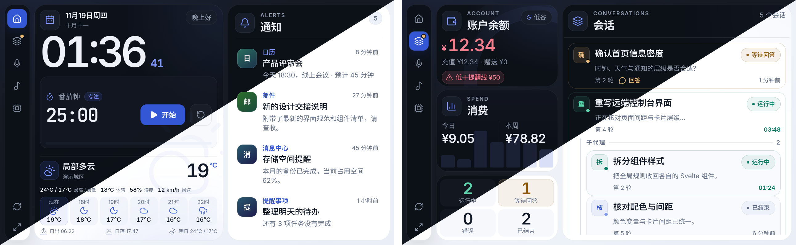
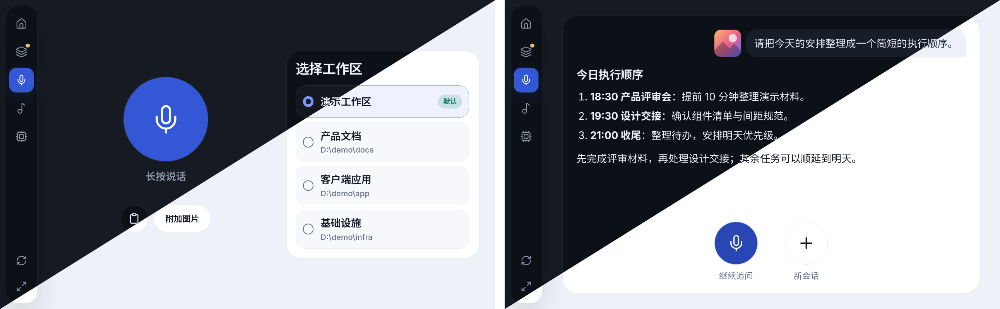
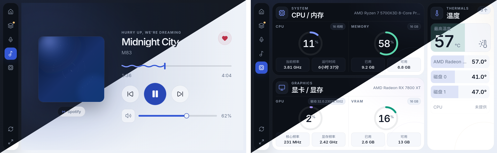

  

<h1 align="center">dsh-remote-control</h1>

  
<strong>给 DSH 配一块放在电脑旁的小副屏</strong>

  
<em>A touch-first LAN console for DeepSeek Harness</em>

  

    
    
    
    
    
  

  
<a href="INSTALLATION.md">安装指南</a> · <strong>简体中文</strong> · <a href="docs/README.en.md">English</a>

---

DSH 在后台运行，放在电脑旁边的手机或平板负责显示状态和快捷操作。会话是否在等你、今天用了多少额度、正在播什么歌，抬头就能看到；回答问询、切歌、调音量，也直接在这块小屏上完成。

控制台通过局域网连接电脑，用浏览器打开即可，手机端不用安装 App。界面按横屏和触屏设计，适合长期放在桌边。

  
   
  <em>主页与会话，暗色与亮色主题。</em>

## 控制台里有六页

| 页面 | 显示与操作 |
|---|---|
| 首页 | 看时间、天气和通知，用番茄钟或倒计时 |
| 会话 | 看余额、消费和会话进度，回答等待中的问题 |
| 快速问答 | 长按说话、选择工作区、附加图片、连续追问 |
| 音乐 | 看封面和进度，切歌、暂停、调节系统音量 |
| 性能 | 看 CPU、内存、GPU、显存、频率与温度 |
| 自定网页 | 把你指定的网页放进控制台，默认关闭 |

  
   
  <em>快速问答：长按说话，也可以带上一张图片。</em>

  
   
  <em>音乐与性能。</em>

## 开始用

推荐让 DSH 里的 agent 代装。新建一个会话，把下面这句发给它：

> 安装 `@ohmykreee/dsh-remote-control` 插件。装好后先读包里的 README.md 和 INSTALLATION.md，再按说明构建媒体、音量、通知、性能与定位需要的本机组件。

也可以自己安装，完整步骤见 **[安装指南](INSTALLATION.md)**。装好后：

1. 重启 DSH，在侧边栏打开 **远程控制台 → 连接**。
2. 让手机与电脑接入同一局域网，扫描页面上的二维码。
3. 手机浏览器打开控制台即可使用；建议添加到主屏幕，横屏体验更好。

时钟、天气、会话和余额等装好后就能用。媒体、音量、系统通知、GPU / 温度和系统定位还需要在电脑上构建一次本机组件；没有它时，这些项目会明确显示不可用，CPU 和内存仍可查看。

快速问答另有前提：在 DSH 中启用官方 **语音输入** 插件并加载语音模型。手机录音还需要 HTTPS 等浏览器安全环境，配置方法同样在安装指南里。

## 连接与隐私

控制台地址和二维码以 **连接** 页显示为准；端口被占用时会自动换用可用端口。首次打开请使用完整扫码链接，手动输入不带验证信息的地址会被拒绝。

你可以关闭或刷新链接验证、限制可访问的网卡、为 HTTPS 提供证书，也可以逐个断开已连接设备。刷新验证会让现有连接失效，适合链接外泄或更换设备时使用。

插件不会把会话、通知或设置上传到第三方服务。天气、城市搜索和法定节假日查询需要联网；使用和风天气时，调用的是你自己的账户与额度。

## 平台支持

| 平台 | 情况 |
|---|---|
| Windows | 支持媒体、音量、性能、通知与定位 |
| Linux | 支持媒体、音量、性能与通知；NVIDIA / AMD GPU 可直接读取，Intel GPU 利用率需要可选工具 |
| macOS | 已在 macOS 26 初步测试；GPU 与温度不可用 |
| 手机 / 平板 | 现代浏览器，优先适配 1280×800 横屏 |

## 已知限制

- 会话内容在手机上只读；开启 **推送问询** 后可以回答普通问题，工具审批仍需在 DSH 中处理。
- 播放器不支持定位时，进度条只能看、不能拖。网易云音乐的红心和精确进度需要额外开启可选功能。
- 中央气象台只覆盖中国城市；和风天气需要你自己的 JWT 凭据。
- 番茄钟和倒计时运行在手机浏览器中，刷新或关闭页面会丢失当前计时。
- 快速问答依赖官方语音输入插件；麦克风与屏幕唤醒锁需要浏览器安全环境。
- 本机组件未构建时，媒体、音量、通知、GPU / 温度和系统定位不可用，其余功能不受影响。

安装、更新、卸载和故障恢复都在 **[INSTALLATION.md](INSTALLATION.md)**。缺陷与需求请提交到仓库 Issues。

## 许可证

[MIT](LICENSE)。Inter、Noto Sans SC、JetBrains Mono 使用 SIL Open Font License 1.1；界面组件来自 MIT 许可的 shadcn-svelte 与 bits-ui，图标来自 ISC 许可的 Lucide。部分媒体适配思路参考 [Widdit/now-playing-service](https://github.com/Widdit/now-playing-service)（MIT）。
