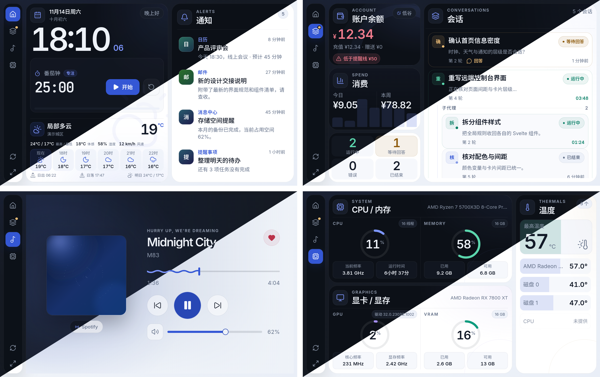
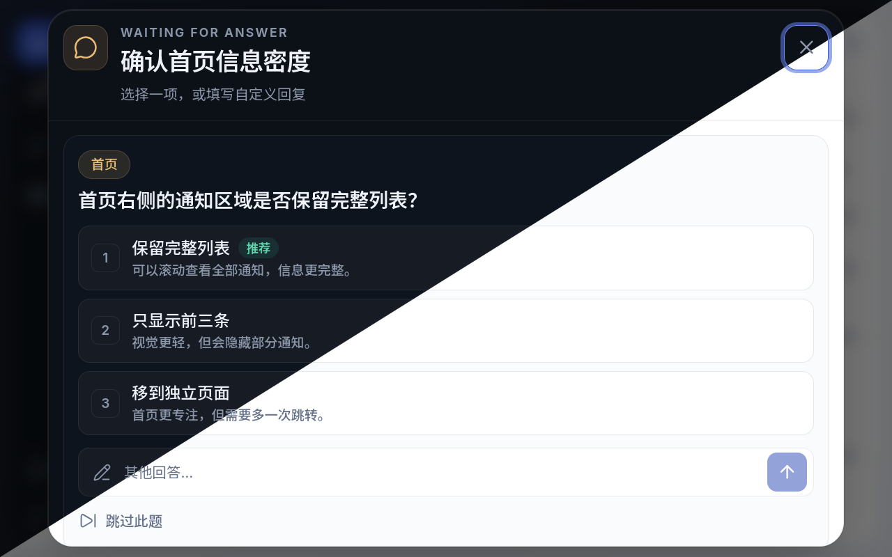

<p align="center">
  
</p>

<h1 align="center">dsh-remote-control</h1>

<div align="center">
  <p><strong>把局域网里的手机变成 DSH 的触屏中控台</strong></p>
  <p><em>A touch-first LAN console for DeepSeek Harness</em></p>

  <p>
    <a href="https://github.com/deepseek-ai/deepseek-harness"></a>
    <a href="https://github.com/ohmykreee/dsh-remote-control/actions/workflows/checks.yml"></a>
    
    
    <a href="LICENSE"></a>
  </p>

  <p>
    安装步骤 → <a href="INSTALLATION.md">INSTALLATION.md</a>
  </p>

  <p>
    <strong>简体中文</strong> · <a href="docs/README.en.md">English</a>
  </p>
</div>

---

手机与电脑在同一局域网时，用手机浏览器打开控制台地址，就能在触屏上查看时钟、天气和系统通知，掌握会话与余额，控制正在播放的音乐和系统音量，并在会话等待回答时直接回复。

## 界面

四页各管一件事：

| 页面 | 内容 |
|---|---|
| 首页 | 大号时钟与日期、当前天气和小时 / 7 天预报、番茄钟或倒计时、系统通知 |
| 会话 | 账户余额、今日 / 本周消费、作为卡片背景的 7 日消费柱、实时会话与子代理、远程回答 |
| 音乐 | 全屏模糊封面、歌曲信息、进度与 seek、上一首 / 下一首、播放暂停、系统音量与静音、网易云红心 |
| 性能 | CPU / 内存与 GPU / 显存圆环、频率与运行时间、最高温度与传感器列表 |

<p align="center">
  
  <br>
  <em>首页 / 会话 / 音乐 / 性能（左上 / 右上 / 左下 / 右下）。每张截图沿右上到左下分割：上方暗色，下方亮色。</em>
</p>

<p align="center">
  
  <br>
  <em>远程提问：选项、推荐标记与自定义回复。</em>
</p>

- 四页可左右循环滑动，一次手势最多前进 / 后退一页；页面顺序、开关与导航栏位置在 DSH 设置页配置。
- 关闭的页面不会显示在手机导航栏。
- 横屏下每页固定一屏高，通知、会话、温度传感器列表在卡片内部滚动；竖屏时整页上下滚动。
- 手机端提供简体中文与英文，选择 **跟随 DSH** 时使用 DSH 当前语言。
- 小屏使用大字号与易点按的触控目标。
- 左下角有快速刷新与全屏按钮。

## 安装

本项目不发布 npm 包，请从源码构建并注册到 DSH：

前置：DSH、Node.js `>= 22`、pnpm、git。

```bash
git clone https://github.com/ohmykreee/dsh-remote-control.git
cd dsh-remote-control
pnpm install
```

```bash
# DSH Desktop；dsh web 用 --profile web
dsh plugin --profile desktop add "link:/path/to/dsh-remote-control"
```

Windows 的路径建议用正斜杠，例如 `link:D:/path/to/dsh-remote-control`。注册后重启 DSH，侧边栏会出现 **远程控制台**。

完整的前置条件、更新、卸载与故障恢复见 [`INSTALLATION.md`](INSTALLATION.md)。

## 连接

- 打开侧边栏 **远程控制台 → 连接**，用手机扫描配对二维码，或复制页面上的控制台地址。手机与电脑需要在同一局域网。
- 默认开启访问验证：首次打开需要扫码链接，缺少验证会显示错误页。验证可以关闭或刷新，刷新后已连接设备会断开。
- 可以只允许指定网卡 / 子网访问。
- 可选 HTTPS：填写证书与私钥文件路径；证书无效时仍使用 HTTP，并在连接页显示错误。
- 端口被占用时会自动选择可用端口，实际地址以连接页显示为准。

## 设置

侧边栏 **远程控制台** 的菜单：

| 菜单 | 内容 |
|---|---|
| 连接 | 二维码、控制台地址、允许访问的网卡、访问验证、HTTPS |
| 偏好设置 | 插件语言、温度单位、主题、页面顺序与开关、导航栏位置 |
| 番茄钟/倒计时 | 启用开关（互斥）、专注 / 休息时长、倒计时预设、提示音 |
| 天气设置 | 定位方式、城市搜索、小时 / 7 天显示、定位权限 |
| 余额显示 | 统计窗口、低余额提醒线、峰谷标记 |
| 通知设置 | 应用开关、显示数量、远程回答 |
| 软件映射 | 修改应用显示名称或恢复默认 |
| 系统信息 | 服务状态、诊断信息与已连接设备 |

修改后点击右上方 **保存设置**；应用改名、主题、令牌刷新和断开设备会立即生效。

## 番茄钟与倒计时

两者都显示在手机端时钟与天气之间，**互斥**，只能启用一个；关闭后从手机端移除。计时在手机浏览器中运行，刷新或关闭页面会丢失当前计时。

| | 番茄钟 | 倒计时 |
|---|---|---|
| 配置 | 专注 / 休息时长，可选「循环响铃直到停止」 | 1–5 个快速预设，默认 3 个 |
| 结束 | 播放提示音，可循环到手动停止 | 卡片变红并显示「时间到」，必须点「确认结束」 |
| 操作 | 开始、暂停、重置 | 选预设、开始、暂停、重置；结束后重置与选预设不可用 |

- 提示音可在 DSH 中配置本机音频文件或 http(s) 链接，留空使用内置的轻柔琶音；倒计时与番茄钟共用。
- 专注与休息时长支持 2 位小数；倒计时预设按「分」「秒」填写，秒数达到 60 会自动进位到分钟。
- 输入超出范围时会自动调整到允许的上下限：番茄钟 0.1–180 分钟（休息 0.1–120），倒计时预设 1–86400 秒。
- 时间到时主页 tab 和浏览器标签页都会显示绿色提示点，倒计时还会触发手机振动（浏览器支持时）。

## 天气

- 自动模式使用本机位置；被拒绝或不可用时使用网络定位，再失败则按所在时区显示。
- Windows 定位可能被系统隐私开关阻挡。设置页 **天气设置 → 请求定位权限** 会发起申请；被拒绝时自动打开系统「位置」设置页，授权成功后刷新天气。
- 手动模式可搜索城市并自动填入坐标，也可以直接编辑纬度与经度。
- 城市搜索与预报会访问外部天气服务，不需要账户或密钥。温度单位支持摄氏度与华氏度，切换后天气、预报与性能页传感器统一使用完整单位符号。
- 自动模式（本机位置）下，手动位置输入框不可编辑。

## 会话与余额

- 余额来自 DSH 账户；用量支持 **本周**（周一 00:00 至今）与 **最近 7 天**（今天及之前 6 个自然日）两种统计窗口。
- 会话页显示近 7 日每日消费柱，柱子作为消费卡背景，最高金额日为 100% 高度。
- 会话状态包括运行中（绿）、等待回答（黄）、错误（红）与已结束；导航图标在等待回答或错误时显示黄 / 红提醒点。
- 子代理会话嵌套在派发它的主代理卡片内并向右缩进；运行中的会话显示累计已运行时间。
- 余额卡片右上角有高峰 / 低谷标记：工作日北京时间 9:00–12:00、14:00–18:00 为高峰；其余时间、周末与法定节假日为低谷（价格为高峰的一半）。标记可在 **余额显示** 中关闭。

### 远程回答

开启 **推送问询** 后，等待回答的会话会出现「回答」入口：点击弹出居中的触屏对话框，展示全部问题、选项与自定义回复输入框。单选题点选项即可回复，多选题可多选后提交，也可以填写自定义回复或跳过该题。

- 手机端只处理 DSH 正常的用户问题；工具审批仍需在 DSH 中处理。
- 远程回答后，DSH 中的提问卡片可能仍需手动关闭。
- 关闭该开关时，会话页保持只读。

## 音乐

- 已适配网易云音乐、QQ 音乐、酷狗音乐、酷我音乐、汽水音乐、全民 K 歌、Spotify、Apple Music、YouTube Music，以及浏览器 / 其他常见播放器。
- 音乐页显示专辑封面、全屏模糊背景、歌曲信息、进度、上一首 / 下一首、播放暂停、系统音量与静音；网易云红心在可用时可点击切换。
- 能否拖动进度取决于播放器是否支持定位；部分播放器只显示进度，无法拖动。读不到进度时不会伪造。
- 网易云音乐的红心与精确进度需要额外开启可选功能，步骤见 [`INSTALLATION.md`](INSTALLATION.md)。
- 封面或歌曲信息不可用时会显示占位，不会编造内容。

## 性能

- 左侧两张卡片分别显示 CPU / 内存和 GPU / 显存，占用率使用圆环；下方小卡片显示当前频率、运行时间、已用 / 可用内存、显存和核心 / 显存频率。
- 右侧温度栏保留大号最高温度与传感器热区背景，GPU 核心温度、磁盘温度与 ACPI 热区在同一列表内；传感器多时在卡片内滚动。
- 读不到的读数会显示「未提供」，不会伪造。
- 部分系统功能在安装后可能显示不可用，请按 [`INSTALLATION.md`](INSTALLATION.md) 检查。

## 通知与软件映射

- 通知来自系统通知中心；手机端显示应用名称、标题、正文、头像与时间。
- 常见应用内置中文名称，其他应用会自动推导名称。
- **软件映射** 可逐个改名或恢复默认，保存后立即用于手机端通知与音乐来源。
- **通知设置** 可为每个应用单独开关通知、限制显示数量（1–20），并控制是否推送问询。

## 安全与隐私

- 默认开启随机访问验证；可关闭或刷新，刷新后所有已连接设备会断开。可限制允许访问的网卡 / 子网。
- 可选 HTTPS；证书无效时回退 HTTP 并显示错误。
- 设置只保存在本机。仓库不包含本机路径、验证信息、证书或通知内容，没有遥测。
- 天气、网络定位与法定节假日查询会访问外部服务；其余数据只在你的电脑与手机之间传输。

## 平台支持

| 平台 | 支持情况 |
|---|---|
| Windows | 完整支持媒体、音量、性能、通知与定位。 |
| Linux | 完整支持媒体、音量、性能与通知；GPU 支持 NVIDIA / AMD。 |
| macOS | 尚未在实机与 CI 验证；GPU 与温度不可用。 |
| 手机端 | 现代浏览器；布局优先 1280×800 横屏。 |

## 已知限制

- 部分系统功能需要安装时一并构建的组件；组件不可用时，媒体、音量、通知、GPU 与温度会显示不可用，CPU / 内存仍可查看。
- Windows 定位需要系统隐私授权；授权被拒绝时可能需要在系统设置中手动开启。
- 只有支持定位的播放器才能拖动进度；部分播放器只能显示进度或全部控制。
- 网易云音乐的红心与精确进度需要额外开启可选功能；页面刷新后可能暂时读取不到，稍后恢复。
- 会话页只读；媒体与音量可写；工具审批不能远程处理。
- 番茄钟与倒计时只在手机浏览器中运行，刷新或关闭页面会丢失。
- 布局优先保证 1280×800 横屏；竖屏为紧凑模式。

## 文档

| 文件 | 内容 |
|---|---|
| [`INSTALLATION.md`](INSTALLATION.md) | 安装、更新、卸载与故障恢复 |
| [`docs/README.en.md`](docs/README.en.md) | English README |
| [`AGENTS.md`](AGENTS.md) | 面向开发者与 agent 的开发说明 |

缺陷与需求走仓库 Issues。

## 许可证

[MIT](LICENSE)。Inter、Noto Sans SC、JetBrains Mono 使用 SIL Open Font License 1.1（`static/fonts/LICENSE.txt`，构建后位于 `web/fonts/LICENSE.txt`）。界面组件来自 MIT 许可的 shadcn-svelte 与 bits-ui，图标来自 ISC 许可的 Lucide；部分媒体适配思路参考 [Widdit/now-playing-service](https://github.com/Widdit/now-playing-service)（MIT）。
