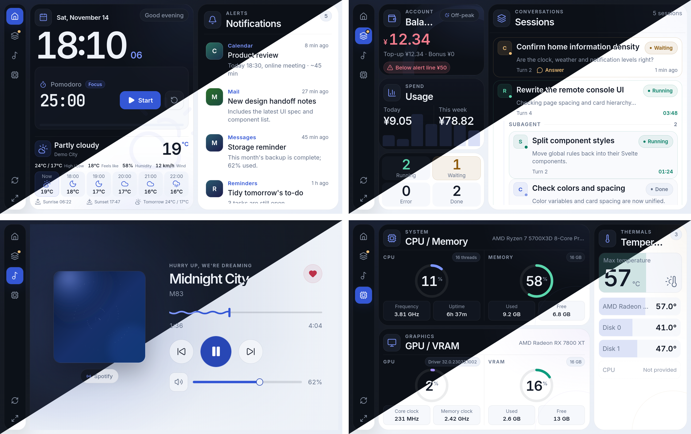
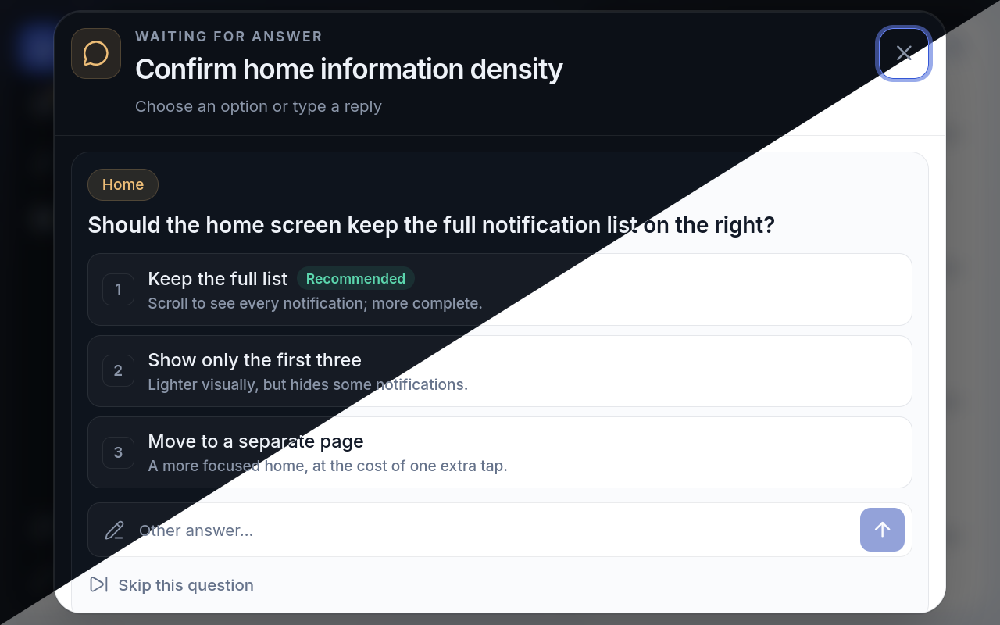

<p align="center">
  
</p>

<h1 align="center">dsh-remote-control</h1>

<div align="center">
  <p><strong>A touch-first LAN console for DeepSeek Harness</strong></p>
  <p><em>把局域网里的手机变成 DSH 的触屏中控台</em></p>

  <p>
    <a href="https://github.com/deepseek-ai/deepseek-harness"></a>
    <a href="https://github.com/ohmykreee/dsh-remote-control/actions/workflows/checks.yml"></a>
    
    
    <a href="../LICENSE"></a>
  </p>

  <p>
    Install steps → <a href="../INSTALLATION.md">INSTALLATION.md</a>
  </p>

  <p>
    <strong>English</strong> · <a href="../README.md">简体中文</a>
  </p>
</div>

---

When your phone and computer share a LAN, open the console address in the phone browser and DSH becomes a touch panel: clock, weather and system notifications; sessions and balance at a glance; playback and system volume; and answers to a session that is waiting on you.

## The pages

Four pages, each with one job:

| Page | What it shows |
|---|---|
| Home | Large clock and date, current weather with hourly / 7-day forecast, Pomodoro or countdown, system notifications |
| Sessions | Account balance, today / this week spend, a 7-day spend chart behind the spend card, live sessions and subagents, remote answers |
| Music | Full-bleed blurred artwork, track info, progress and seek, previous / next, play-pause, system volume and mute, NetEase Cloud Music like |
| Performance | CPU / memory and GPU / VRAM rings, clocks and uptime, hottest temperature and sensor list |

<p align="center">
  
  <br>
  <em>Home / Sessions / Music / Performance (top-left / top-right / bottom-left / bottom-right). Each capture is split from top-right to bottom-left: dark above, light below.</em>
</p>

<p align="center">
  
  <br>
  <em>Remote question: options, the recommended marker and a custom reply.</em>
</p>

- The four pages loop horizontally, one page per gesture; page order, enablement and the navigation rail position are configured on the DSH settings page.
- Disabled pages do not appear in the phone rail.
- In landscape each page is one screen tall, with notifications, sessions and temperature sensors scrolling inside their cards; portrait allows the whole page to scroll.
- The phone UI ships in Simplified Chinese and English. **Follow DSH** uses the current DSH language.
- Small screens use larger type and easy-to-tap controls.
- A quick refresh button and a fullscreen button sit at the bottom left.

## Install

This project is not published on npm. Build it from source and register it with DSH:

Requirements: DSH, Node.js `>= 22`, pnpm, git.

```bash
git clone https://github.com/ohmykreee/dsh-remote-control.git
cd dsh-remote-control
pnpm install
```

```bash
# DSH Desktop; use --profile web for dsh web
dsh plugin --profile desktop add "link:/path/to/dsh-remote-control"
```

On Windows prefer forward slashes, for example `link:D:/path/to/dsh-remote-control`. Restart DSH after registering; the **Remote control** panel appears in the sidebar.

See [`INSTALLATION.md`](../INSTALLATION.md) for prerequisites, updates, uninstall and recovery.

## Connecting

- Open **Remote control → Connection** in the sidebar, then scan the pairing QR code with your phone or copy the console address. Phone and computer must share a LAN.
- Access verification is on by default: the first visit needs the scanned link, and a missing verification shows an error page. You can turn it off or refresh it; refreshing disconnects every connected device.
- You can allow only selected network interfaces / subnets.
- Optional HTTPS: provide certificate and private-key file paths. If the certificate is invalid the console stays on HTTP and shows the error on the connection page.
- If the port is taken, another available port is chosen automatically. The connection page always shows the actual address.

## Settings

The **Remote control** sidebar has these groups:

| Group | Contents |
|---|---|
| Connection | QR code, console address, allowed interfaces, access verification, HTTPS |
| Preferences | Plugin language, temperature unit, theme, page order and toggles, navigation position |
| Pomodoro / countdown | Enable switch (mutually exclusive), focus / break lengths, countdown presets, alert sound |
| Weather | Location mode, city search, hourly / 7-day display, location access |
| Balance | Spend window, low-balance threshold, peak / off-peak marker |
| Notifications | Per-app toggles, display limit, remote answers |
| App names | Rename apps or reset their default names |
| System information | Service status, diagnostics, and connected devices |

Click **Save settings** to apply changes. Renaming an app, theme changes, refreshing access verification and disconnecting a device take effect immediately.

## Pomodoro and countdown

Both sit between the clock and the weather on the phone, are **mutually exclusive**, and only one can be enabled; disabling one removes it from the phone. Timers run in the phone browser, so refreshing or closing the page loses the current run.

| | Pomodoro | Countdown |
|---|---|---|
| Setup | Focus / break lengths, optional "ring until stopped" | 1–5 quick presets, 3 by default |
| At zero | Plays the alert sound, optionally looping until stopped | The card turns red and shows "Time's up"; you must confirm |
| Controls | Start, pause, reset | Pick a preset, start, pause, reset; reset and presets are locked until confirmed |

- The alert sound can be a local audio file or an http(s) URL configured in DSH; leave it empty for the built-in soft arpeggio. Countdown and Pomodoro share it.
- Focus and break lengths accept two decimals. Countdown presets are entered as minutes and seconds; seconds at or above 60 carry into minutes automatically.
- Values outside the allowed range adjust automatically: pomodoro 0.1–180 minutes (break 0.1–120), countdown presets 1–86400 seconds.
- At zero the Home rail tab and the browser tab both show a green dot, and the countdown also vibrates the phone when the browser supports it.

## Weather

- Automatic mode uses the computer's location. If it is unavailable or denied, network location is used; if that also fails, the time zone is used.
- Windows may block location through a privacy switch. **Weather → Request location access** asks for permission; when denied, the system Location settings page opens. Refresh after granting access.
- Manual mode searches for a city and fills in the coordinates, or you can edit latitude and longitude directly.
- City search and forecasts contact an external weather service; no account or key is required. Temperature units support Celsius and Fahrenheit, and the choice applies to weather, forecasts and performance sensors.
- In automatic mode the manual location fields are read-only.

## Sessions and balance

- Balance comes from the DSH account. Usage supports **This week** (Monday 00:00 to now) and **Last 7 days** (today plus the previous six calendar days).
- The sessions page shows a 7-day daily spend chart behind the spend card, with the highest day at 100% height.
- Session states are running (green), waiting for an answer (yellow), error (red) and finished. The rail icon shows yellow / red dots while a session is waiting or has errored.
- Subagent sessions are nested inside the parent card and indented. Running sessions show their accumulated run time.
- The balance card has a peak / off-peak marker: weekdays 09:00–12:00 and 14:00–18:00 Beijing time are peak; other times, weekends and public holidays are off-peak at half the peak price. The marker can be turned off under **Balance**.

### Remote answers

Turn on **Push inquiries** and sessions waiting for an answer gain an **Answer** entry. Tapping it opens a centered touch dialog with every question, its options and a custom reply field. Single-choice questions accept one tap; multiple-choice questions can be combined with a custom reply, or you can skip a question.

- The phone handles normal DSH user questions only; tool approvals still happen in DSH.
- After answering remotely, the question card in DSH may still need to be closed manually.
- With the switch off, the sessions page stays read-only.

## Music

- Supports NetEase Cloud Music, QQ Music, KuGou, KuWo, Soda Music, WeSing, Spotify, Apple Music, YouTube Music, plus browsers and other common players.
- The music page shows album art, a full-bleed blurred background, track info, progress, previous / next, play-pause, system volume and mute. NetEase Cloud Music's like button is clickable when available.
- Whether the progress bar can be dragged depends on the player supporting seek; some players only show progress. When progress is unavailable it is never fabricated.
- NetEase Cloud Music's like state and exact progress need an optional feature enabled; see [`INSTALLATION.md`](../INSTALLATION.md).
- Missing artwork or track details show a placeholder instead of invented content.

## Performance

- The left cards show CPU / memory and GPU / VRAM with radial gauges. Small cards below show current clocks, uptime, used / free memory, VRAM and core / memory clocks.
- The right column keeps a large hottest temperature and heat-tinted sensor list, combining GPU core, disk and ACPI sensors; long lists scroll inside the card.
- Readings that are unavailable show "Not provided" instead of guessed values.
- Some system features may show unavailable after installation; check [`INSTALLATION.md`](../INSTALLATION.md) if that happens.

## Notifications and app names

- Notifications come from the system notification centre and show the app name, title, body, avatar and time on the phone.
- Common apps ship with localized names; other apps get a name derived automatically.
- **App names** lets you rename any app or reset its default; changes apply to phone notifications and music sources immediately.
- **Notifications** lets you toggle each app, limit how many items are shown (1–20), and control whether questions are pushed.

## Security and privacy

- Access verification is random and enabled by default. You can turn it off or refresh it; refreshing disconnects every connected device. You can allow only selected network interfaces / subnets.
- Optional HTTPS; an invalid certificate falls back to HTTP with an error shown.
- Settings stay on this computer. The repository contains no local paths, verification secrets, certificates or notification content, and there is no telemetry.
- Weather, network location and public-holiday lookups contact external services; all other data stays between your computer and your phone.

## Platform support

| Platform | Support |
|---|---|
| Windows | Full media, volume, performance, notifications and location support. |
| Linux | Full media, volume, performance and notifications support; GPU support for NVIDIA / AMD. |
| macOS | Not yet verified on hardware or CI; GPU and temperature are unavailable. |
| Phone | Modern browser; layout is optimised for 1280×800 landscape. |

## Known limitations

- Some system features rely on components built during installation. If those components are unavailable, media, volume, notifications, GPU and temperature show unavailable; CPU / memory still work.
- Windows location needs system privacy permission; if it is denied you may need to enable it in system settings.
- Only players that support seek allow dragging the progress bar; some players show progress only or offer no transport controls.
- NetEase Cloud Music's like state and exact progress require an optional feature; they may be briefly unavailable after a page refresh.
- The sessions page is read-only; media and volume are writable; tool approvals cannot be handled remotely.
- Pomodoro and countdown run only in the phone browser, so refreshing or closing the page loses them.
- Layout is optimised for 1280×800 landscape; portrait is a compact fallback.

## Documentation

| File | Contents |
|---|---|
| [`INSTALLATION.md`](../INSTALLATION.md) | Install, update, uninstall and recovery |
| [`README.md`](../README.md) | Chinese README |
| [`AGENTS.md`](../AGENTS.md) | Developer and agent notes |

Bugs and feature requests go to the repository Issues.

## License

[MIT](../LICENSE). Inter, Noto Sans SC and JetBrains Mono use the SIL Open Font License 1.1 (`static/fonts/LICENSE.txt`, bundled to `web/fonts/LICENSE.txt`). UI components come from MIT-licensed shadcn-svelte and bits-ui; icons come from ISC-licensed Lucide; some media-adapter ideas are based on [Widdit/now-playing-service](https://github.com/Widdit/now-playing-service) (MIT).
