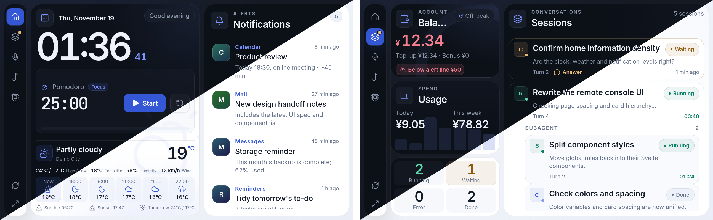
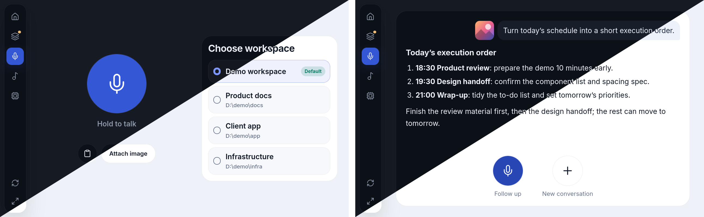
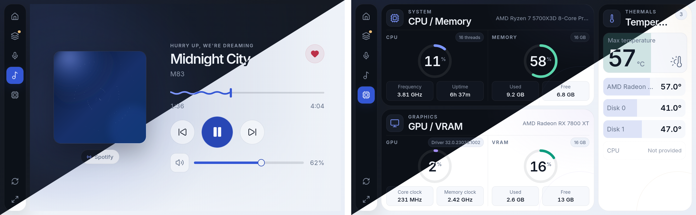

  

<h1 align="center">dsh-remote-control</h1>

  
<strong>A small companion display for DSH, right beside your computer</strong>

  

    
    
    
    
    
  

  
<a href="../INSTALLATION.md">Installation guide</a> · <strong>English</strong> · <a href="../README.md">简体中文</a>

---

DSH runs in the background while a phone or tablet beside your computer shows its status and provides quick controls. See whether a session is waiting, how much you have spent today, or what is playing; answer a question, change tracks, or adjust the volume on the small screen.

The console connects to your computer over the LAN and opens in a browser, with no phone app to install. Its landscape, touch-friendly layout suits a screen that stays on your desk.

  
   
  <em>Home and Sessions, in dark and light themes.</em>

## The six pages

| Page | Information and controls |
|---|---|
| Home | Check the time, weather and notifications; run a Pomodoro or countdown |
| Sessions | Check balance, spending and session progress; answer waiting questions |
| Quick Q&A | Hold to talk, pick a workspace, attach an image and ask follow-ups |
| Music | View artwork and progress, change tracks, pause and adjust system volume |
| Performance | Check CPU, memory, GPU, VRAM, clocks and temperatures |
| Custom page | Keep a web page of your choice inside the console; off by default |

  
   
  <em>Quick Q&amp;A: hold to talk, with an optional image.</em>

  
   
  <em>Music and Performance.</em>

## Get started

You can ask a DSH agent to install it. Start a new session and send:

> Install the `@ohmykreee/dsh-remote-control` plugin. Once installed, read its README.md and INSTALLATION.md, then follow those instructions to build the local component needed for media, volume, notifications, performance and location.

To install it yourself, follow the **[installation guide](../INSTALLATION.md)**. Then:

1. Restart DSH and open **Remote control → Connection** in the sidebar.
2. Connect your phone and computer to the same LAN, then scan the QR code.
3. Open the console in your phone browser. Add it to your home screen if you like; landscape is the best fit.

The clock, weather, sessions and balance work after installation. Media, volume, system notifications, GPU / temperatures and system location also need a local component built once on your computer. Without it, those items clearly show as unavailable, while CPU and memory still work.

Quick Q&A has one more prerequisite: enable DSH's official **Voice Input** plugin and load its speech model. Phone recording also needs a browser secure context such as HTTPS; the installation guide explains how to set that up.

## Connection and privacy

Use the address and QR code shown under **Connection**. If the default port is occupied, the console picks an available one. Open the full scanned link on your first visit; an address entered without its verification details will be rejected.

You can turn link verification off or rotate it, restrict accessible network interfaces, provide a certificate for HTTPS, and disconnect individual devices. Rotating verification invalidates existing links, which is useful after sharing one by mistake or changing devices.

The plugin does not upload sessions, notifications or settings to third-party services. Weather, city search and public-holiday lookups require internet access; QWeather uses your own account and quota.

## Platform support

| Platform | Support |
|---|---|
| Windows | Media, volume, performance, notifications and location |
| Linux | Media, volume, performance and notifications; NVIDIA / AMD GPUs work directly, while Intel GPU utilization needs an optional tool |
| macOS | Preliminary testing on macOS 26; GPU and temperatures are unavailable |
| Phone / tablet | A modern browser, optimised for 1280×800 landscape |

## Known limitations

- Session content is read-only on the phone. With **Push inquiries** enabled you can answer normal questions, but tool approvals still require DSH.
- A player that does not support seeking gets a read-only progress bar. NetEase Cloud Music likes and exact progress require an optional extra setup.
- NMC covers Chinese cities only; QWeather requires your own JWT credentials.
- Pomodoro and countdown timers run in the phone browser, so refreshing or closing the page loses the current timer.
- Quick Q&A depends on the official Voice Input plugin. The microphone and screen wake lock require a browser secure context.
- Without the local component, media, volume, notifications, GPU / temperatures and system location are unavailable. Everything else is unaffected.

Installation, updates, removal and recovery are covered in **[INSTALLATION.md](../INSTALLATION.md)**. Please use the repository Issues for bugs and feature requests.

## License

[MIT](../LICENSE). Inter, Noto Sans SC and JetBrains Mono use the SIL Open Font License 1.1. UI components come from MIT-licensed shadcn-svelte and bits-ui, and icons from ISC-licensed Lucide. Some media-adapter ideas are based on [Widdit/now-playing-service](https://github.com/Widdit/now-playing-service) (MIT).
