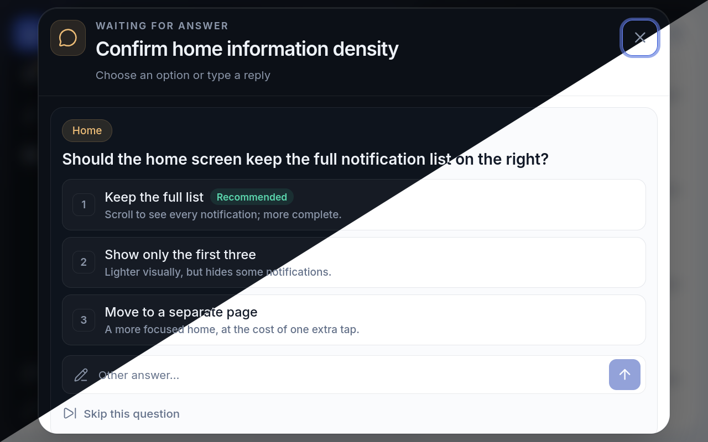

  

<h1 align="center">dsh-remote-control</h1>

  
<strong>A touch-first LAN console for DeepSeek Harness</strong>

  
<em>把局域网里的手机变成 DSH 的触屏中控台</em>

  

    
    
    
    
    
  

  

    Install steps → <a href="../INSTALLATION.md">INSTALLATION.md</a>
  

  

    <strong>English</strong> · <a href="../README.md">简体中文</a>
  

---

When your phone and computer share a LAN, open the console address in the phone browser and DSH becomes a touch panel: clock, weather and system notifications; sessions and balance at a glance; playback and system volume; answers to a session that is waiting on you; and a large hold-to-talk button for quick questions.

## The pages

Five pages, each with one job:

| Page | What it shows |
|---|---|
| Home | Large clock and date, current weather with hourly / 7-day forecast, Pomodoro or countdown, system notifications |
| Sessions | Account balance, today / this week spend, a 7-day spend chart behind the spend card, live sessions and subagents, remote answers |
| Quick Q&A | A large voice button, default / pinned workspace picker, model answers and follow-ups |
| Music | Full-bleed blurred artwork, track info, progress and seek, previous / next, play-pause, system volume and mute, NetEase Cloud Music like |
| Performance | CPU / memory and GPU / VRAM rings, clocks and uptime, hottest temperature and sensor list |

  
   
  <em>Home / Sessions / Music / Performance (top-left / top-right / bottom-left / bottom-right). Each capture is split from top-right to bottom-left: dark above, light below.</em>

  
   
  <em>Remote question: options, the recommended marker and a custom reply.</em>

- The five pages loop horizontally, one page per gesture; page order, enablement and the navigation rail position are configured on the DSH settings page.
- Disabled pages do not appear in the phone rail.
- In landscape each page is one screen tall, with notifications, sessions and temperature sensors scrolling inside their cards; portrait allows the whole page to scroll.
- The phone UI ships in Simplified Chinese and English. **Follow DSH** uses the current DSH language.
- Small screens use larger type and easy-to-tap controls.
- A quick refresh button and a fullscreen button sit at the bottom left.

## Install

**Recommended: let the DSH agent install it.** Start a new DSH session and send it this line:

> Install the `@ohmykreee/dsh-remote-control` plugin. Once it is installed, read its README.md and INSTALLATION.md first, then follow them to build the local component that media, volume, notifications, performance and location need.

The agent installs the plugin, reads both documents, builds the component and tells you to restart DSH; if build tools are missing it says which ones.

**To install manually**, start with [`INSTALLATION.md`](../INSTALLATION.md): npm install, source install, component build, updates and troubleshooting all live there.

## Connecting

- Open **Remote control → Connection** in the sidebar, then scan the pairing QR code with your phone or copy the console address. Phone and computer must share a LAN.
- Access verification is on by default: the first visit needs the scanned link, and a missing verification shows an error page. You can turn it off or refresh it; refreshing disconnects every connected device.
- You can allow only selected network interfaces / subnets.
- Optional HTTPS: provide certificate and private-key file paths. If the certificate is invalid the console stays on HTTP and shows the error on the connection page.
- When HTTPS is active and the certificate carries a concrete DNS name (SAN or CN), the pairing link and QR code use that domain instead of the interface IP; wildcard-only or IP-only certificates keep the LAN address.
- If the port is taken, another available port is chosen automatically. The connection page always shows the actual address.

## Settings

The **Remote control** sidebar has these groups:

| Group | Contents |
|---|---|
| Connection | QR code, console address, allowed interfaces, access verification, HTTPS, and advanced features (disabled while HTTPS is off) |
| Preferences | Plugin language, temperature unit, theme, page order and toggles, navigation position |
| Quick Q&A | Official voice-input status, reply model and reasoning effort, default / pinned workspaces with their mode and permission behavior |
| Pomodoro / countdown | Enable switch (mutually exclusive), focus / break lengths, countdown presets, alert sound |
| Weather | Data provider, location mode, city search, QWeather JWT credentials and monthly limit, call-count sync, hourly / 7-day display, location access |
| Balance | Spend window, low-balance threshold, peak / off-peak marker |
| Notifications | Per-app toggles, display limit, remote answers |
| App names | Rename apps or reset their default names |
| System information | Service status, diagnostics, and connected devices |

Click **Save settings** to apply changes. Renaming an app, theme changes, refreshing access verification and disconnecting a device take effect immediately.

## Pomodoro and countdown

Both sit between the clock and the weather on the phone, are **mutually exclusive**, and only one can be enabled; disabling one removes it from the phone. Timers run in the phone browser, so refreshing or closing the page loses the current run.

| | Pomodoro | Countdown |
|---|---|---|
| Setup | Focus / break lengths, optional "ring until stopped" | 1–5 quick presets, 3 by default |
| At zero | Plays the alert sound, optionally looping until stopped | The card turns red and shows "Time's up"; you must confirm |
| Controls | Start, pause, reset | Pick a preset, start, pause, reset; reset and presets are locked until confirmed |

- The alert sound can be a local audio file or an http(s) URL configured in DSH; leave it empty for the built-in soft arpeggio. Countdown and Pomodoro share it.
- Focus and break lengths accept two decimals. Countdown presets are entered as minutes and seconds; seconds at or above 60 carry into minutes automatically.
- Values outside the allowed range adjust automatically: pomodoro 0.1–180 minutes (break 0.1–120), countdown presets 1–86400 seconds.
- At zero the Home rail tab and the browser tab both show a green dot. When the phone supports vibration, a one-shot alert vibrates once; a looping alert (including the countdown) keeps vibrating until you stop ringing or confirm.

## Weather

- Choose **NMC** (Central Meteorological Observatory), **Open-Meteo** or **QWeather**. The settings list follows the automatic-switch priority: NMC → Open-Meteo → QWeather.
- NMC and Open-Meteo need no account or key. NMC uses city stations and covers Chinese cities only.
- QWeather uses JWT authentication only. Create a project and JWT credential in the QWeather console, then fill in API Host, project ID, credential ID, developer ID and the Ed25519 private key under **Weather → QWeather JWT authentication**. The private key stays in the local settings file, and the plugin generates short-lived JWTs automatically. The settings page can generate a key pair for first-time setup.
- Enable these QWeather console permissions: **GeoAPI** (city search), **Weather forecast** (current / hourly / 7-day) and **Air quality** (today's AQI; hidden automatically when the plan does not support it) under API permissions; and **Allow access to finance summary** plus **Allow access to request statistics summary** under the credential's console permissions (used for the monthly count and the last-24-hour stats).
- QWeather calls are counted per calendar month, including weather, city searches and console queries, with a default limit of 47,500 (5% headroom under the 50,000 free quota). The refresh interval is given a safe minimum for the configured limit. When the limit is reached the console switches to NMC for Chinese cities or Open-Meteo elsewhere, and returns to QWeather next month.
- QWeather settings can enable **Sync console call count** (off by default). Before a weather query it reads the console's last-24-hour request stats and monthly usage when available, at most once every three hours. Console queries also use the free quota. If the console does not return a monthly count (common on free accounts), the settings page says so and free users are advised to turn the sync off. The monthly count is the local counter, including weather, GeoAPI and console queries.
- Automatic mode uses the system location; when it is unavailable, the time zone is used.
- Windows may block location through a privacy switch. **Weather → Request location access** asks for permission; when denied, the system Location settings page opens. Refresh after granting access.
- Manual mode only needs a city search and selection; the matched coordinates or NMC station ID appear in the location hint.
- When the current provider supplies today's air quality, the weather card shows the AQI and its level in the feels-like / humidity / wind row; otherwise the item is hidden.
- City search and forecasts contact external weather services; QWeather calls count against your own account quota. Temperature units support Celsius and Fahrenheit, and the choice applies to weather, forecasts and performance sensors.

## Sessions and balance

- Balance comes from the DSH account. Usage supports **This week** (Monday 00:00 to now) and **Last 7 days** (today plus the previous six calendar days).
- The sessions page shows a 7-day daily spend chart behind the spend card, with the highest day at 100% height.
- Session states are running (green), waiting for an answer (yellow), error (red) and finished. The rail icon shows yellow / red dots while a session is waiting or has errored.
- Subagent sessions are nested inside the parent card and indented. Running sessions show their accumulated run time.
- The balance card has a peak / off-peak marker: weekdays 09:00–12:00 and 14:00–18:00 Beijing time are peak; other times, weekends and public holidays are off-peak at half the peak price. The marker can be turned off under **Balance**.

### Remote answers

Turn on **Push inquiries** and sessions waiting for an answer gain an **Answer** entry. Tapping it opens a centered touch dialog with every question, its options and a custom reply field. Single-choice questions accept one tap; multiple-choice questions can be combined with a custom reply, or you can skip a question.

- The phone handles normal DSH user questions only; tool approvals still happen in DSH.
- After answering remotely, the question card in DSH may still need to be closed manually.
- With the switch off, the sessions page stays read-only.

## Quick Q&A

- Enable the official **Voice Input** plugin in DSH and download / load its speech model first. The first block under **Remote control → Quick Q&A** shows whether it is ready. While it is not ready, the model and workspace settings below stay disabled and the phone refuses new questions; saved settings are kept.
- Reply model and reasoning effort come from the models currently available on this machine. Without an explicit choice, the DSH default model is used.
- The default workspace is selected automatically when the quick page opens. Workspaces marked as pinned appear beside it for switching. The workspace list also comes from this machine.
- Each pinned workspace row holds its checkbox, mode, and permission behavior; the two selects are disabled until the workspace is checked. The default workspace is always checked and can set the same two values. Only the default and pinned workspaces keep these two settings when saved.
- On the phone, hold the large button to record and release to transcribe and send. While holding, move to the Cancel button and release there to discard the recording. Too-short or silent recordings are not sent and a retry hint appears.
- Answering switches to one centered chat card: it shows the recognized question, the previous turns in the same conversation, and the final answer. Reasoning and tool calls stay hidden. Afterwards you can follow up in the same conversation or start a new one. When following up, the recording control stays on the small round button at the bottom of the card instead of returning to the initial page. The bottom buttons hide while the model is answering and return when the answer is complete.
- The inquiry sheet is controlled by **Notifications → Push inquiries**: when on, the existing sheet opens directly; when off, the page tells you to handle it in DSH. Permission requests still need confirmation in DSH.
- The microphone uses the phone browser's default input device, with no device picker. The first use needs browser permission; an Allow microphone button appears above the large circle until then. Browsers only allow recording on HTTPS or localhost pages.

## Music

- Supports NetEase Cloud Music, QQ Music, KuGou, KuWo, Soda Music, WeSing, Spotify, Apple Music, YouTube Music, plus browsers and other common players.
- When several players are open, a playing player with higher priority is shown first; if it pauses, a playing browser or other player takes over.
- The music page shows album art, a full-bleed blurred background, track info, progress, previous / next, play-pause, system volume and mute. NetEase Cloud Music's like button is clickable when available.
- Whether the progress bar can be dragged depends on the player supporting seek; some players only show progress. When progress is unavailable it is never fabricated.
- NetEase Cloud Music's like state and exact progress need an optional feature enabled; see [`INSTALLATION.md`](../INSTALLATION.md).
- Missing artwork or track details show a placeholder instead of invented content.

## Performance

- The left cards show CPU / memory and GPU / VRAM with radial gauges. Small cards below show current clocks, uptime, used / free memory, VRAM and core / memory clocks.
- The right column keeps a large hottest temperature and heat-tinted sensor list, combining GPU core, disk and ACPI sensors; long lists scroll inside the card.
- Readings that are unavailable show "Not provided" instead of guessed values.
- Some system features may show unavailable after installation; check [`INSTALLATION.md`](../INSTALLATION.md) if that happens.

## Notifications and app names

- Notifications come from the system notification centre and show the app name, title, body, avatar and time on the phone.
- Common apps ship with localized names; other apps get a name derived automatically.
- **App names** lets you rename any app or reset its default; changes apply to phone notifications and music sources immediately.
- **Notifications** lets you toggle each app, limit how many items are shown (1–20), and control whether questions are pushed.

## Security and privacy

- Access verification is random and enabled by default. You can turn it off or refresh it; refreshing disconnects every connected device. You can allow only selected network interfaces / subnets.
- Optional HTTPS; an invalid certificate falls back to HTTP with an error shown.
- Settings stay on this computer. The repository contains no local paths, verification secrets, certificates, QWeather private keys or notification content, and there is no telemetry.
- Weather and public-holiday lookups contact external services; with QWeather the requests go to your own QWeather API Host. All other data stays between your computer and your phone.

## Platform support

| Platform | Support |
|---|---|
| Windows | Full media, volume, performance, notifications and location support. |
| Linux | Full media, volume, performance and notifications support; GPU support for NVIDIA / AMD, Intel integrated/discrete GPUs need optional `intel-gpu-tools`. |
| macOS | Preliminary testing completed on macOS 26; GPU and temperature are unavailable. |
| Phone | Modern browser; layout is optimised for 1280×800 landscape. |

## Known limitations

- Media, volume, notifications, GPU / temperature and system location need one component built on your own computer. Until it is built those features show unavailable; CPU / memory still work.
- Windows location needs system privacy permission; if it is denied you may need to enable it in system settings.
- NMC covers Chinese cities only.
- QWeather needs your own JWT credentials; reaching the calendar-month limit switches to NMC or Open-Meteo and returns next month.
- Only players that support seek allow dragging the progress bar; some players show progress only or offer no transport controls.
- NetEase Cloud Music's like state and exact progress require an optional feature; they may be briefly unavailable after a page refresh.
- The sessions page is read-only; media and volume are writable; tool approvals cannot be handled remotely.
- Quick Q&A needs the official DSH Voice Input plugin to be enabled and prepared; otherwise it cannot be configured or used. The phone microphone needs HTTPS or a localhost page and browser permission.
- The wake lock needs HTTPS and browser support; the system releases it while the page is in the background and it is restored when the page returns.
- Pomodoro and countdown run only in the phone browser, so refreshing or closing the page loses them.
- Landscape pages stay one screen tall; portrait pages scroll vertically and cards grow with their content.

## Documentation

| File | Contents |
|---|---|
| [`INSTALLATION.md`](../INSTALLATION.md) | Install, update, uninstall and recovery |
| [`README.md`](../README.md) | Chinese README |
| [`AGENTS.md`](../AGENTS.md) | Developer and agent notes |

Bugs and feature requests go to the repository Issues.

## License

[MIT](../LICENSE). Inter, Noto Sans SC and JetBrains Mono use the SIL Open Font License 1.1 (`static/fonts/LICENSE.txt`, bundled to `web/fonts/LICENSE.txt`). UI components come from MIT-licensed shadcn-svelte and bits-ui; icons come from ISC-licensed Lucide; some media-adapter ideas are based on [Widdit/now-playing-service](https://github.com/Widdit/now-playing-service) (MIT).
